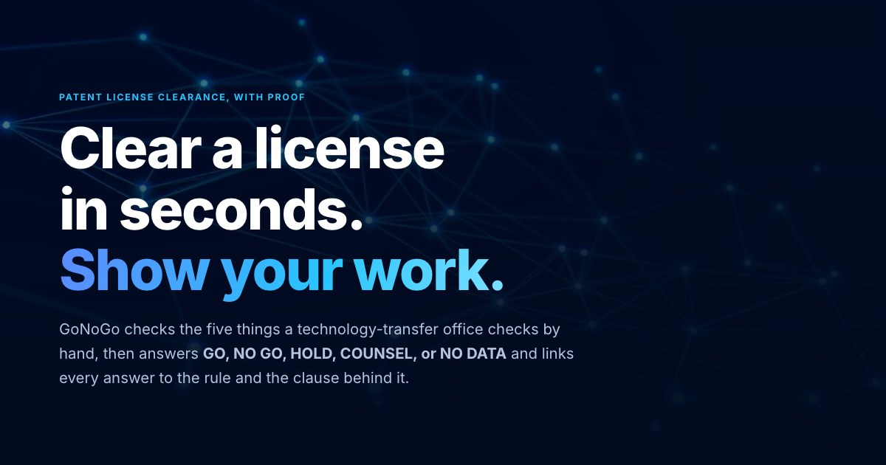
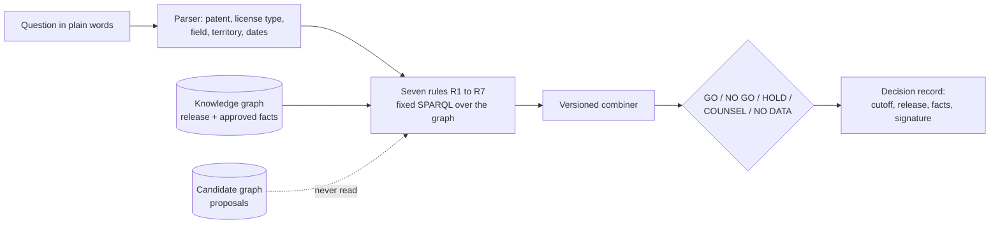

# GoNoGo

**Can this company license this patent, for this use, in this place, for these years? GoNoGo answers in about a second and shows the proof.**

[](https://abh2050.github.io/gonogo/)

**[Open the site](https://abh2050.github.io/gonogo/)** for the story, the benchmark, and the architecture, or
**[try the live demo](https://gonogo-livid.vercel.app/#/ask)** and ask a question yourself.

## The problem

A licensing manager at a NASA center gets a request: a company wants a license to a patent, for one use, in one
territory, for some years. A clearance means five checks by hand:

1. Is the patent still in force?
2. Does a signed license already cover the same use and territory?
3. Is a public notice of intent still open for objections?
4. Does export control allow the company's country?
5. Has every co-owner consented?

A missed overlap can put two exclusive licenses on one invention. The error that costs most is clearing a license
that should have been blocked, because nothing flags it.

## What GoNoGo does

It runs the five checks (as seven rules) over a knowledge graph and answers with one of five verdicts:

| Verdict | Meaning |
|---|---|
| **GO** | Every check that applies passed. |
| **NO GO** | A check failed, such as an overlapping exclusive grant. |
| **HOLD** | A notice window is still open. |
| **COUNSEL** | A person with legal judgment must decide. |
| **NO DATA** | A fact is missing, so GoNoGo does not guess. A missing fact is never a yes. |

Each verdict names the rule that decided it and links every fact that rule read to its source.



A language model may read a question or propose a fact. It never decides a verdict and never writes a query that
decides one. A proposed fact counts only after a person approves it, and an approval that conflicts with the
record, or that would raise a verdict to GO, waits for a second person
([ADR 0002](docs/adr/0002-separation-of-duties.md)).


## Does the ontology earn its place?

Two hundred clearance questions went to four ways of answering, scored against verdicts that were fixed by hand when
each case was planted. All four had the same facts ([docs/benchmark.md](docs/benchmark.md)).

| | Vector RAG | Graph agent | Rules only | **GoNoGo** |
|---|---:|---:|---:|---:|
| Verdict accuracy | 20.5% | 72.5% | 50.5% | **97.5%** |
| **False GO** (answered GO where the answer was not GO) | 14 | 32 | 0 | **0** |
| Cited the agreement that decides the case | 21% | 91% | 48% | **100%** |
| Model cost for 200 questions | $1.04 | $4.35 | $0 | **$0.20** |

The graph agent cited the deciding agreement 91% of the time and still misapplied the rule. GoNoGo lets a model
read the question and lets the rules decide, and the build fails if it ever gives a false GO. The questions are
synthetic and few, and one model (Claude Haiku 4.5) was used throughout; the write-up says what that does and does
not show.

## Architecture

The same engine runs in two places: a public demo on Vercel that needs no cloud account, and an AWS deployment with
Neptune, Cognito, Verified Permissions, Lambda, Step Functions, and CloudFront, built with the AWS CDK in Python.


Seven draw.io views cover the request path, ingestion, security and network, data access, the benchmark, and the
stacks and their cost: [docs/architecture/README.md](docs/architecture/README.md).

A narrated five-minute tour of the ontology, provenance, the verdict path, the AWS design, and the benchmark:
[docs/media/gonogo-overview.mp4](docs/media/gonogo-overview.mp4), with subtitles in
[gonogo-overview.srt](docs/media/gonogo-overview.srt).

## Read next

| Read | What it gives you |
|---|---|
| [docs/benchmark.md](docs/benchmark.md) | The benchmark: method, results, why each answerer fails, and what it does not show |
| [docs/ontology-from-scratch.md](docs/ontology-from-scratch.md) | Start here if you have never heard of an ontology: triples, OWL, SKOS, SHACL, SPARQL, then the build in twelve steps |
| [docs/ontology-guide.md](docs/ontology-guide.md) | The model on one page, each construct with the test that proves it, and one patent followed through the graph |
| [docs/modeling-decisions.md](docs/modeling-decisions.md) | Sixteen modeling decisions, each with the problem, the choice, the reason, the cost, and the evidence |
| [docs/rules.md](docs/rules.md) | The seven rules, the combiner, the decision record, the steward loop, and when one person is not enough |
| [docs/ingestion.md](docs/ingestion.md) | How an agreement PDF becomes a proposed grant, waits for a steward, and reaches the graph |
| [docs/adr/](docs/adr/README.md) | Three decisions: upper-ontology alignment, separation of duties, and RDF versus a property graph |
| [docs/security-tests.md](docs/security-tests.md) | What the leakage and prompt-injection suites attack, what they found, and what they do not prove |
| [docs/aws.md](docs/aws.md) and [docs/aws-resources.md](docs/aws-resources.md) | What ran on AWS, the checks against it, and all 106 resources with their idle cost |
| [docs/media-rights.md](docs/media-rights.md) | Which parts of the architecture carry over to media rights clearance, and which patent rules do not |
| [docs/status.md](docs/status.md) | What each gate delivered, what it cost, and what is still open |

The machine-readable ontology is in [ontology/](ontology/) (OWL 2 and SKOS), and the shapes are in
[shapes/](shapes/) (SHACL). Generated reference documentation is in [docs/ontology/](docs/ontology/).

## Run it

```bash
uv sync
uv run uvicorn api.index:app --port 8000      # the API, over a snapshot of the graph
cd ui && npm install && npm run dev            # the app, with /api forwarded to port 8000
```

The app draws the ontology as a graph, shows how a grant for a broader field covers narrower ones, charts what the
real data showed, lets you drag a recording cutoff through the bitemporal model, and runs the Ask, Steward, History,
and Benchmark pages against the real rule engine. [docs/public-demo.md](docs/public-demo.md) explains how the demo
keeps working with no AWS account.

To rebuild everything from the public sources:

```bash
cp .env.example .env              # add USPTO_API_KEY from data.uspto.gov > My ODP
uv run python -m ingest all       # fetches and caches public data under data/raw/
uv run python -m synth --seed 42  # writes data/synthetic/
docker compose up -d --wait       # Fuseki on :3030, Neo4j on :7474 and :7687
uv run python -m kg all           # build the graph, materialize inference, run SHACL, load into Fuseki
uv run pytest                     # the offline suite: shapes, competency questions, graph build, rules, and more
uv run pytest -m docker           # competency questions on a real Fuseki server, Neo4j, and Ontop
uv run pytest -m robot            # HermiT consistency checks (needs Java)
```

Local work costs nothing. The AWS stacks deploy only when you ask for them, Neptune sits behind `deployNeptune`,
`scripts/teardown.py` removes everything after a session, and a $10 budget watches the services they use. See
[infra/README.md](infra/README.md).

### Explore the graph in Neo4j Browser

The same approved grants, vocabularies, and provenance also load into Neo4j as a property graph, so you can click
through them. This copy is for exploring and for the comparison in
[ADR 0003](docs/adr/0003-rdf-versus-property-graph.md); the rules never read it.

```bash
docker compose up -d --wait neo4j    # Neo4j 5 Community on :7474 and :7687
uv run python -m pgraph.load         # about 770 nodes and 1,200 relationships
```

Open [http://localhost:7474/browser/](http://localhost:7474/browser/) and sign in with user `neo4j` and password
`gonogo-local` (or your `NEO4J_PASSWORD`). Then try:

```cypher
// Every node label and how they connect
CALL db.schema.visualization()

// One patent with its grants, licensees, fields, territories, and source documents
MATCH (p:Patent {key: "LEW-18461-2"})<-[:ABOUT]-(g:Grant)
OPTIONAL MATCH (g)-[r]->(x)
RETURN p, g, r, x

// The field-of-use hierarchy
MATCH path = (f:Field)-[:BROADER*1..3]->(:Field)
RETURN path LIMIT 80

// Rule R2 in Cypher: grants that overlap a request, walking the hierarchy both ways
MATCH (g:ExecutedGrant)-[:ABOUT]->(:Patent {key: "LEW-18461-2"}),
      (g)-[:FIELD]->(gf:Field), (rf:Field {id: "spacecraft-systems"})
WHERE EXISTS { (rf)-[:BROADER*0..]->(gf) } OR EXISTS { (gf)-[:BROADER*1..]->(rf) }
RETURN g, gf, rf
```

Click a node for its properties, and double-click it to expand its neighbors. The full rule is
[pgraph/r2.cypher](pgraph/r2.cypher), and `uv run python -m pgraph.compare` checks it against the SPARQL version.

## The data

GoNoGo uses real public data: NASA's patent list, USPTO legal status, NASA technology portal records, Federal
Register notices of intent to license, and NASA technical reports. [docs/data-sources.md](docs/data-sources.md)
lists each source, the endpoint that worked, and the record counts.

NASA does not publish executed license agreements, ownership records, or export classifications. The generator in
`synth/` creates them with a fixed seed. Every synthetic agreement names a fictional licensee and carries the line
"SYNTHETIC DOCUMENT" on its first page. In the graph, every synthetic fact carries `prov:wasGeneratedBy` the
generator run.

## What carries over to media rights

The architecture carries over to media rights clearance: an ontology written from the questions, vocabularies for
territories and media, an open world where a missing fact is not a yes, facts with two times and a source,
confidential terms in their own graph, rules that decide while a model only reads, two people for risky approvals,
and decisions that can be rerun. The patent rules do not. Patent terms and fee lapses, the co-exclusive cap, the
federal notice window, export control, and statutory review give way to chain of title, windows and holdbacks, and
rights split by territory and medium. [docs/media-rights.md](docs/media-rights.md) goes through each.
