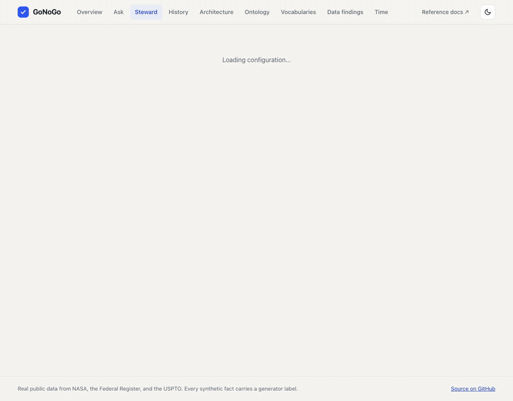

# GoNoGo

GoNoGo answers one question for NASA's technology transfer office: can this company license this patent,
for this field of use, in this territory, for this term? It answers GO, NO GO, HOLD, COUNSEL, or NO DATA, and
it shows the rule that decided, the facts that rule read, and the clause each fact came from.

Seven deterministic rules decide every verdict by querying a W3C knowledge graph through fixed SPARQL
templates. A missing fact gives NO DATA, never GO, and a proposed fact counts only after a person approves it.
A language model may propose a field of use from a notice, but it never decides a verdict and never writes a
query that decides one. Its proposals wait in a queue until a person approves them, and an approval that
conflicts with the record, or that would move a verdict to GO, waits for a second person. The public demo calls
no model.

**Try it:** [gonogo-livid.vercel.app](https://gonogo-livid.vercel.app/#/ask). Pick "No export classification
yet", approve the proposed classification on the Steward page, and the verdict moves from NO DATA to GO, with
R5 named as the rule that changed. [docs/rules.md](docs/rules.md) walks through that example.




A one-minute video of both walks: [docs/media/gonogo-overview.mp4](docs/media/gonogo-overview.mp4).

> **Status:** Gate 3 of 4 is complete: the two-person rule enforced by Cedar, the leakage and prompt-injection
> suites, the AWS deployment (built, checked on Neptune, and torn down), the Ontop mapping, and the release
> workflow. Gate 4 adds the benchmark. See [docs/status.md](docs/status.md).

## Read next

| Read | What it gives you |
|---|---|
| [docs/tour.md](docs/tour.md) | The app in pictures: the ontology in motion, a question, a held approval, the policy grid, and the provenance graph |
| [docs/architecture.md](docs/architecture.md) | Six diagrams: the path to a verdict, the two places it runs, the AWS deployment, the two-person rule, the data and who reads it, and the release process. The demo has the same pictures on its Architecture page. |
| [docs/aws-resources.md](docs/aws-resources.md) | All 106 AWS resources, generated from the CDK templates, with what each is for and what it costs while idle |
| [docs/rules.md](docs/rules.md) | The seven rules, the combiner, the decision record, the steward loop, and when one person is not enough |
| [docs/adr/0002-separation-of-duties.md](docs/adr/0002-separation-of-duties.md) | Why a conflicting or verdict-changing approval needs counsel, and how Cedar enforces it |
| [docs/security-tests.md](docs/security-tests.md) | What the leakage and prompt-injection suites attack, what they found, and what they do not prove |
| [docs/aws.md](docs/aws.md) | What ran on AWS, eleven checks against it, what is not built, and what went wrong |
| [docs/release-process.md](docs/release-process.md) | How a change to the rules becomes a release, with an impact report and counsel's approval |

## The ontology, in four places

| Read | What it gives you |
|---|---|
| [docs/ontology-guide.md](docs/ontology-guide.md) | The model on one page, each ontology construct with the test that proves it, and one real patent followed through the graph |
| [docs/modeling-decisions.md](docs/modeling-decisions.md) | Thirteen modeling decisions, each with the problem, the choice, the reason, the cost, and the evidence |
| [ontology/competency_questions.md](ontology/competency_questions.md) | Fifteen competency questions, each an executable SPARQL template with hand-worked answers |
| [docs/adr/0001-upper-ontology-alignment.md](docs/adr/0001-upper-ontology-alignment.md) | Why GoNoGo reuses PROV-O, SKOS, Dublin Core, and schema.org, and imports neither BFO, CCO, nor FIBO |

The machine-readable files live in [ontology/](ontology/) (OWL 2 and SKOS) and [shapes/](shapes/) (SHACL).
Generated reference documentation is in [docs/ontology/](docs/ontology/).

## See it

The [ui/](ui/) folder holds a React app that draws the ontology as a graph, shows how a grant for a broader
field covers the narrower ones, charts what the real data showed, and lets you drag a recording cutoff
through the bitemporal model. Its Ask, Steward, and History views call the API in [api/](api/), which runs
the real rule engine over a snapshot of the graph.

```bash
uv run uvicorn api.index:app --port 8000   # the API
cd ui && npm install && npm run dev         # the app, with /api forwarded to port 8000
```

[docs/public-demo.md](docs/public-demo.md) explains how the interactive demo keeps working after the AWS
stack is torn down.

## Data

GoNoGo uses real public data from five NASA and federal sources, including USPTO legal status, and labels
every synthetic fact as synthetic. [docs/data-sources.md](docs/data-sources.md) lists each source, the
endpoint that worked, and the record counts.

NASA does not publish executed license agreements, ownership records, or export classifications. The
generator in `synth/` creates them with a fixed seed. Every synthetic agreement names a fictional licensee
and carries the line "SYNTHETIC DOCUMENT" on its first page. In the graph, every synthetic fact carries
`prov:wasGeneratedBy` the generator run.

## Run it locally

```bash
uv sync
cp .env.example .env             # add USPTO_API_KEY from data.uspto.gov > My ODP
uv run python -m ingest all      # fetches and caches public data under data/raw/
uv run python -m synth --seed 42 # writes data/synthetic/
docker compose up -d --wait      # Fuseki on :3030, Neo4j on :7474 and :7687
uv run python -m kg all          # build the graph, materialize inference, run SHACL, load into Fuseki
uv run pytest                    # offline suite: shapes, competency questions, graph build
uv run pytest -m docker          # competency questions on a real Fuseki server
uv run pytest -m robot           # HermiT consistency checks (needs Java)
uv run pytest -m network         # live calls to the public sources
```

Local work costs nothing. The AWS stack deploys only when you ask for it. Neptune sits behind `deployNeptune`,
`scripts/teardown.py` removes everything after a session, and a $10 budget watches the services it uses. See
[infra/README.md](infra/README.md).
