# GoNoGo

**Can this company license this patent, for this use, in this place, for these years? Get an answer and the evidence behind it.**

[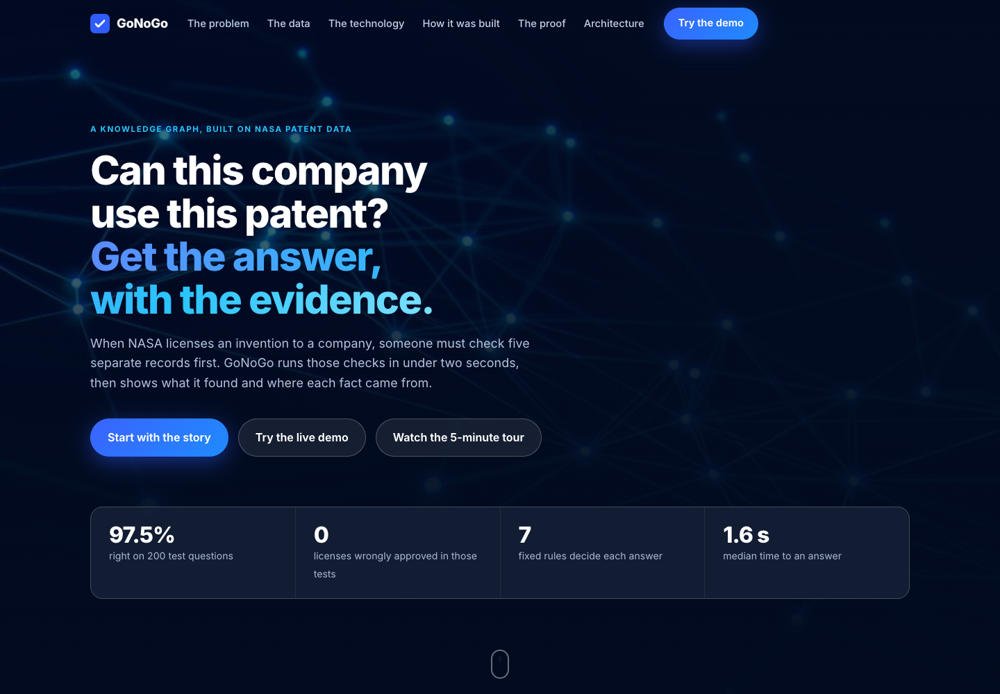](https://abh2050.github.io/gonogo/)

**[Explore the website](https://abh2050.github.io/gonogo/)** · **[Try a clearance question](https://gonogo-livid.vercel.app/#/ask)** · **[Watch the five-minute tour](docs/media/gonogo-overview.mp4)** · **[Read the benchmark](docs/benchmark.md)**

GoNoGo is a patent-license clearance application built on NASA public data. It brings scattered records into a knowledge graph, checks a request against seven rules, and returns a verdict with the facts and source clauses that explain it. People approve new evidence; decisions keep enough context to be reproduced later.

| Accuracy on 200 benchmark questions | False GO decisions in that benchmark | Median answer time | Model cost for those 200 questions |
|---:|---:|---:|---:|
| **97.5%** | **0** | **1.557 seconds** | **$0.20** |

These are the recorded results for GoNoGo with its optional model reader enabled. The public demo uses a deterministic parser and makes no model calls. [Results, method, and limits](#the-results) explain the distinction.

**Start here:** [The problem](#the-problem) → [Ontology in plain words](#ontology-in-plain-words) → [The app](#a-question-becomes-a-decision) → [The engine](#how-the-engine-works) → [Governance](#how-evidence-earns-trust) → [Results](#the-results) → [Architecture](#the-complete-architecture) → [Run it](#run-it-locally).

## The problem

A company wants to license a NASA invention. Before a licensing manager can say yes, five things need checking:

1. **The patent:** is it still in force?
2. **Existing rights:** does another signed license already cover the same use, territory, and dates?
3. **Public notice:** is a notice of intent still open for objections?
4. **Export control:** may the licensee's country receive the technology?
5. **Ownership:** has every co-owner consented?

The answers sit in different places: a patent list, legal-status records, notices, and agreement PDFs. A missed overlap can put two exclusive licenses on one invention. A missing ownership record can look like “no co-owners” unless the system preserves the difference between **unknown** and **confirmed**.

GoNoGo makes those checks explicit. A missing fact is never a yes.

## Ontology in plain words

An **ontology** is a shared dictionary that also describes how things relate. Here, it defines a *Patent*, a *Licensee*, and a *Grant*. It says that a grant concerns a patent, names a licensee, and covers a use, a territory, and a period of time.

A **knowledge graph** holds the actual facts using those definitions. A few illustrative facts read like short sentences:

```text
An executed grant → concerns → a patent
That grant        → names   → a licensee
That grant        → covers  → optics, in the United States, during its term
Optics            → includes → lasers
```

That last relationship matters. An exclusive grant for optics can overlap a request for lasers, even though the words differ. GoNoGo checks the hierarchy in both directions: a broad request can also overlap a narrower grant.


The explorer connects each class to its definition, the rules that use it, and the modeling decision behind it. [Open the ontology explorer](https://gonogo-livid.vercel.app/#/ontology).

### The few terms you need

| Term | Plain meaning | Its job in GoNoGo |
|---|---|---|
| **RDF** | Facts written as subject → relationship → object | Connect patents, grants, parties, and evidence. |
| **OWL** | Machine-readable definitions and logic | Distinguish proposed from executed grants and derive rights coverage. |
| **SKOS** | Named concepts arranged into vocabularies | Give fields of use and territories stable meanings and broader/narrower relationships. |
| **SHACL** | Checks that data has the required shape | Reject malformed facts and evidence before approval. It does not decide clearance. |
| **SPARQL** | A language for querying an RDF graph | Retrieve the exact facts each rule needs using fixed templates. |
| **PROV-O** | A vocabulary for recording where things came from | Trace a fact to its source, proposal, approval, and responsible person. |


The vocabulary is part of the decision: changing a hierarchy can change which rights overlap. It therefore goes through the same versioned release process as a rule change.

For a slower introduction, read [Ontology from zero to a full build](docs/ontology-from-scratch.md). For the exact model, see [the ontology guide](docs/ontology-guide.md), [the Turtle definitions](ontology/gonogo.ttl), and [the generated reference](docs/ontology/index.html).

<details>
<summary>See the full ontology screenshot and the model's class relationships</summary>


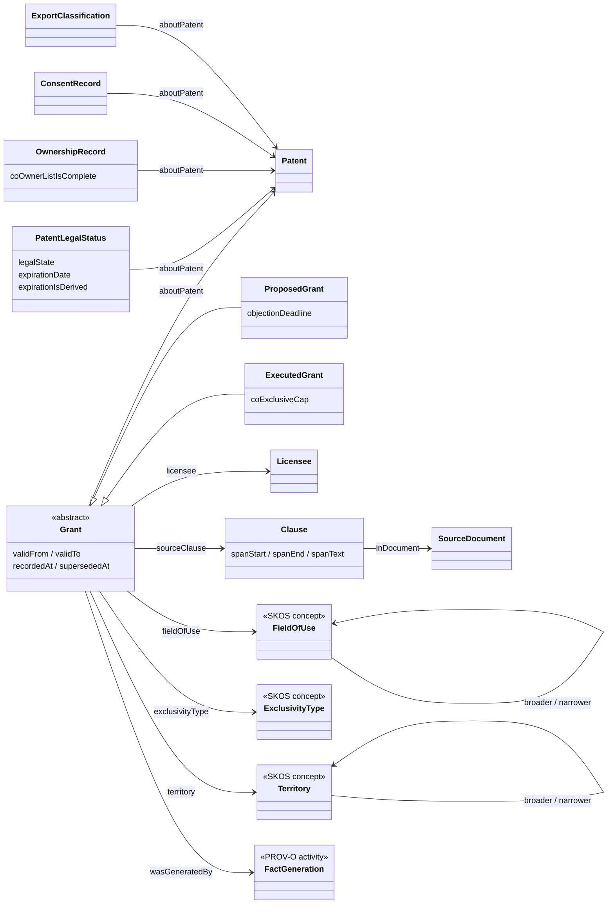

The diagram omits the shared bitemporal superclass to keep the relationships readable. Legal status, ownership, consent, export classifications, and grants all keep their times and provenance.

</details>

## A question becomes a decision

### 1. Ask in ordinary language

> Orbital Lens Works, Inc. wants a non-exclusive license to NASA case LAR-17381-1 for alloys in United States from January 1, 2027 to December 31, 2031.

The parser identifies the licensee, patent, license type, use, territory, and dates. The app underlines what it understood. If a required part is missing, it asks for it before attempting a verdict.


### 2. Read the verdict and its evidence

This request returns **COUNSEL**: the ownership record lists a co-owner, and no consent is on record. The card shows all seven findings, including the checks that passed.


| Verdict | What it means |
|---|---|
| **GO** | Every applicable check passed. |
| **NO GO** | A check failed, such as an overlapping exclusive grant. |
| **HOLD** | A notice window is still open. |
| **COUNSEL** | A person with legal judgment must decide. |
| **NO DATA** | A required fact is missing or incomplete. |

**NEEDS INFO** is a request-level response before those verdicts: the question itself cannot be completed, for example because it omits the field of use or names an out-of-scope patent.

### 3. Follow a fact back to its source

Every finding names the facts it read. Evidence links lead back to a source clause; approved facts also record who proposed and approved them. The provenance view makes that chain visible.


The [live demo](https://gonogo-livid.vercel.app/#/ask) lets you ask, inspect evidence, review proposals, and revisit decisions. Its session belongs to your browser: **Start over** returns to the committed graph snapshot.

## How the engine works

The five business checks become **seven explicit rules**, including a co-exclusive cap and statutory review. A parser turns a sentence into a structured request. Entity resolution identifies the company. Fixed queries read approved facts, and a versioned combiner turns the findings into one verdict.

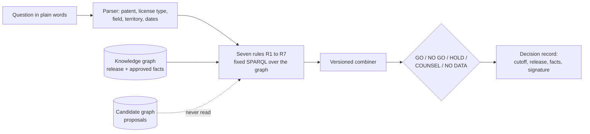

A language model may read a question into a form or propose a fact. Every proposed request value must resolve to an allowed concept, patent, or date. The model never decides a verdict or writes a query that decides one. The public demo uses fixed parsing; the benchmark also measures the optional model reader.

| Rule | What it checks | A consequence worth knowing |
|---|---|---|
| **R1 · Patent in force** | Legal status and dates at the requested start | A lapsed patent can produce NO GO; insufficient evidence produces NO DATA. |
| **R2 · Overlapping grants** | Use, territory, term, and exclusivity | An overlapping executed exclusive grant blocks a conflicting request; an overlapping proposal may require counsel. |
| **R3 · Co-exclusive cap** | The number of grants against the stated cap | An unstated cap is unknown, rather than unlimited. |
| **R4 · Notice window** | The requester's public notice and objection deadline | An open window produces HOLD. |
| **R5 · Export control** | Classification and the licensee's country | A restriction may require counsel; a missing classification is unknown. |
| **R6 · Co-owner consent** | A complete ownership record and every required consent | A missing consent requires counsel; a missing ownership record is unknown. |
| **R7 · Statutory review** | Whether the request belongs to the exclusive-license family | Every exclusive-family request requires counsel and cannot reach GO automatically. |

The combiner applies this precedence: **FAIL → NO GO**, then **PENDING → HOLD**, **REVIEW → COUNSEL**, **UNKNOWN → NO DATA**, otherwise **GO**. NOT_APPLICABLE findings do not affect it. Every rule still runs, so a blocking finding does not hide other problems. [Full rule semantics and source](docs/rules.md).

### Two times make old decisions reproducible

A fact has both **valid time**—when it applies in the world—and **recording time**—when the system learned it. A correction can change today's answer without silently rewriting what an earlier decision knew.


Each decision records its canonical request, evaluation time, recording cutoff, ontology release, rule and combiner versions, facts read, findings, and a SHA-256 signature over the canonical findings. Replaying it at its stored cutoff reproduces the original result. The signature is a reproducibility check over the findings.

## How evidence earns trust

New evidence enters a **candidate graph**. Clearance rules never read it. A steward must approve a proposal before it becomes a fact the rules can use.

Before approval, the engine tries the change on a copy of the graph. If it conflicts with approved evidence or would move a decision from COUNSEL or NO GO to GO, the approval waits for a different counsel. A proposer cannot approve their own work.

### One person's approval can be held

In the example below, a proposed ownership record drops a co-owner. Accepting it would remove the consent requirement. The steward's approval is held; the graph and the COUNSEL verdict stay unchanged.


### A different counsel completes the review

Counsel checks the evidence, supplies a reason, and gives the second approval. The decision changes to GO, and the resulting fact names both approvers.


### Access follows policy

Six roles and 21 Cedar policies govern actions and graph access. The app asks the policies to populate this grid. On AWS, the caller's identity and role come from a verified Cognito token. In the public demo, visitors choose a role to explore the behavior.


Royalty terms and full agreement text sit in a confidential named graph. Neither enters the public snapshot. The query service checks explicit graph access before executing a query. [Separation-of-duties decision](docs/adr/0002-separation-of-duties.md) · [Security tests and their limits](docs/security-tests.md).

## The data behind the decisions

GoNoGo combines five public sources with explicitly labeled synthetic records:

| Source | What it contributes |
|---|---|
| NASA Patents | The patent catalog: 1,393 processed records. |
| NASA Technology Transfer portal | Additional technologies and patent identifiers; 289 technologies at the three selected centers. |
| USPTO | Legal status, fee lapses, reinstatements, and recorded co-assignees. |
| Federal Register | 92 intent-to-grant notices, including objection deadlines and any stated use. |
| NASA Technical Reports Server | 172 related reports for retrieval and context. |
| Fixed-seed synthetic generator | 120 executed agreements, plus ownership, consent, export, and test-case records that public sources do not provide. |

The final scope contains **300 patents and 41 notices**. Counts and retrieval details are recorded in [the data-source report](docs/data-sources.md).


The source checks changed the build. Of 263 candidates that NASA's snapshot called in force on the project's evaluation date and that had a USPTO record, **181 were lapsed for unpaid maintenance fees**. Only **24 of 92 notices** stated a field of use. Those gaps become explicit facts or unknowns.

Executed licenses, complete ownership records, consent, and export classifications are synthetic here. Every synthetic agreement names a fictional licensee, carries **SYNTHETIC DOCUMENT** on its first page, and has generator provenance in the graph. Real public records and synthetic augmentation remain distinguishable.

## The results

### Four methods, the same questions and facts

The benchmark contains **200 questions**: 45 planted cases asked four ways, plus 20 questions that cannot be answered as written. Expected verdicts were stated by hand when the cases were planted. They were not generated by the engine being scored. All answerers had the same underlying facts; the retrieval corpus contained 1,925 documents.

| Answerer | How it reaches an answer |
|---|---|
| **A · Vector RAG** | Retrieves 12 similar passages, then asks the model to apply the policy. |
| **B · Graph agent** | Uses tools backed by exact SPARQL queries, then asks the model to apply the policy. |
| **C · Rules only** | Uses the fixed parser and the seven rules. No model. |
| **C+ · GoNoGo with a model reader** | Lets a model fill missing request fields when fixed parsing falls short; the seven rules decide. |

Model-using answerers used Claude Haiku 4.5 on Amazon Bedrock at temperature 0. The table below preserves the full summary from the [generated results report](eval/results.md).

| | A. Vector RAG | B. Graph agent | C. Rules only | C+. Rules with a model reader |
|---|---:|---:|---:|---:|
| Verdict accuracy | 20.5% | 72.5% | 50.5% | 97.5% |
| Cases with all four wordings right | 27.7% | 50.8% | 30.8% | 92.3% |
| **False GO** (answered GO, should not be) | **14** | **32** | **0** | **0** |
| False GO rate | 9.0% | 20.5% | 0.0% | 0.0% |
| Missed GO rate | 90.9% | 11.4% | 54.5% | 2.3% |
| Citation precision | 93.8% | 99.3% | 100.0% | 100.0% |
| Cites the decisive agreement | 21.4% | 91.1% | 48.2% | 100.0% |
| Search returned a record of the patent | 35.6% | n/a | n/a | n/a |
| Median latency | 3.374 s | 25.174 s | 0.006 s | 1.557 s |
| 95th percentile latency | 11.35 s | 51.596 s | 0.234 s | 7.586 s |
| Model calls | 200 | 867 | 0 | 114 |
| Tokens in / out | 840,304 / 39,846 | 3,082,499 / 254,163 | 0 / 0 | 106,129 / 18,555 |
| Model cost (Haiku 4.5 on-demand) | $1.04 | $4.35 | $0.00 | $0.20 |
| Errors | 0 | 0 | 0 | 0 |

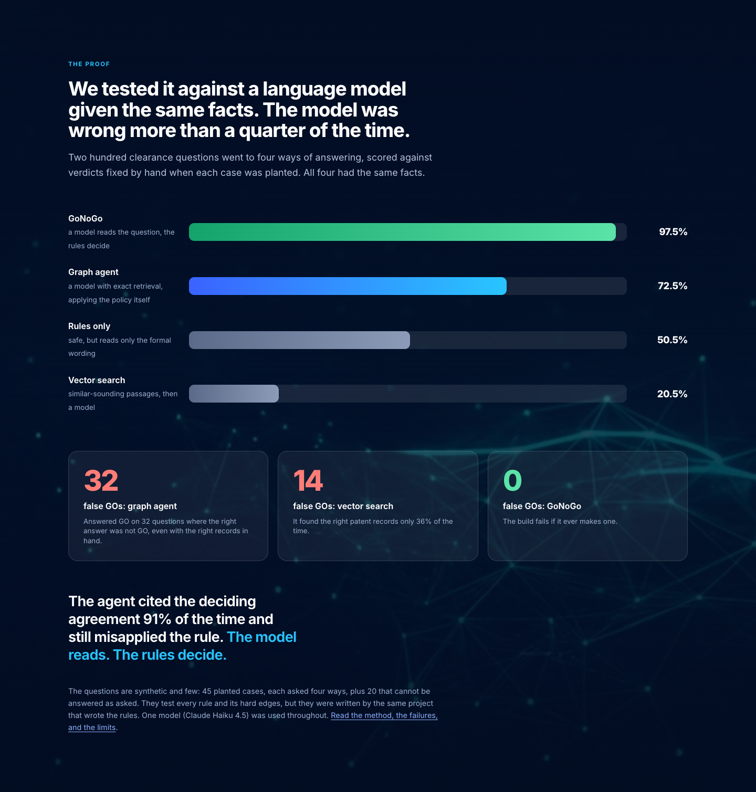

The graph agent cited the decisive agreement **91.1%** of the time and still made **32 false GOs**. Its written reasons show misapplied exclusivity rules and missing evidence treated as permission. Better retrieval alone did not resolve those errors in this run.

GoNoGo was right on **195 of 200 questions**, with **zero false GOs**. The rules-only version also made zero false GOs but could not read casual and terse wordings. The optional model reader improved request parsing while leaving the verdict logic in the rules.

### The five misses and the limits

All five GoNoGo misses came from noisy wordings where the parser failed to identify the licensee. The resulting missing country or requester evidence led to NO DATA or COUNSEL. None produced GO. The recorded runs and their errors remain in [eval/](eval/).

The cases are synthetic and small in number, and four wordings of one case are not four independent tests. The project authored both the policy implementation and the cases. One model was tested; a larger model, a different policy prompt, or a stronger retrieval baseline could change the comparison. Zero false GOs in these cases is an observed result, not a guarantee for unseen requests. [Method, failure analysis, and limitations](docs/benchmark.md).

<details>
<summary>All question-family and wording results, plus both benchmark screenshots</summary>

**Accuracy by question family**

| Family | Questions | A. Vector RAG | B. Graph agent | C. Rules only | C+. Rules with a model reader |
|---|---:|---:|---:|---:|---:|
| Baselines and steward loop | 16 | 2/16 | 14/16 | 7/16 | 16/16 |
| Combiner order | 8 | 1/8 | 5/8 | 3/8 | 7/8 |
| Corrections | 8 | 0/8 | 7/8 | 4/8 | 8/8 |
| Planted instructions | 12 | 1/12 | 10/12 | 5/12 | 12/12 |
| R1 patent in force | 28 | 4/28 | 20/28 | 13/28 | 28/28 |
| R2 overlapping grants | 44 | 6/44 | 29/44 | 22/44 | 44/44 |
| R3 co-exclusive cap | 12 | 4/12 | 9/12 | 5/12 | 11/12 |
| R4 notice window | 8 | 4/8 | 8/8 | 3/8 | 7/8 |
| R5 export control | 12 | 0/12 | 9/12 | 4/12 | 10/12 |
| R6 co-owner consent | 16 | 1/16 | 11/16 | 8/16 | 16/16 |
| Terms in time | 16 | 1/16 | 13/16 | 7/16 | 16/16 |
| Unanswerable | 20 | 17/20 | 10/20 | 20/20 | 20/20 |

**Accuracy by wording**

| Wording | A. Vector RAG | B. Graph agent | C. Rules only | C+. Rules with a model reader |
|---|---:|---:|---:|---:|
| formal | 2.2% | 75.6% | 100.0% | 100.0% |
| casual | 6.7% | 77.8% | 0.0% | 100.0% |
| terse | 8.9% | 75.6% | 0.0% | 100.0% |
| noisy | 35.6% | 71.1% | 80.0% | 88.9% |
| unanswerable | 85.0% | 50.0% | 100.0% | 100.0% |


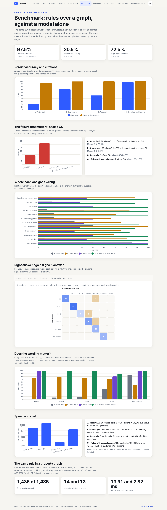

[Every false GO, its question and reason, and the full verdict confusion tables](eval/results.md#every-false-go) remain in the generated report.

</details>

### Evidence beyond the benchmark

These are recorded project checks, with their scope kept separate from the 200-question comparison.

| Check | Recorded result | Evidence |
|---|---|---|
| Offline test suite at Gate 4 | 1,111 passed, 1 skipped | [Status log](docs/status.md#gate-4-the-benchmark-the-neo4j-comparison-ingestion-and-the-readme) |
| R2 in SPARQL versus Cypher | Same conflicting grants for **1,435 of 1,435 requests** | [RDF versus property graph](docs/adr/0003-rdf-versus-property-graph.md) |
| Neptune versus the in-memory engine | **43 of 43 decision signatures matched** | [AWS evidence](docs/aws-evidence.json) |
| Local Cedar versus Verified Permissions | **126 of 126 authorization decisions matched** | [AWS evidence](docs/aws-evidence.json) |
| Deployed query-service leakage tests | **500 queries**, 382 refused, **0 leaked royalty text** | [Security report](docs/security-tests.md) |
| Live prompt-injection measurement | Sonnet 4.6 answered “none stated” on **36 of 36** notices with planted instructions | [Raw measurement](docs/injection-results.json) |
| Fixed-pattern agreement extraction | **101 of 120** agreements read exactly; **19 refused** for human review; none read incorrectly | [Ingestion report](docs/ingestion.md) |
| Live agreement ingestion | Both samples completed; AGR-0901 changed a booked request **GO → NO GO**, while AGR-0902 left GO unchanged | [Run record](docs/ingestion-run.json) |

The injection measurement is small; the security report explains its limits. The stronger design property is that model proposals remain outside the graphs read by the rules until approved.

The Neo4j comparison also exposed a loader bug: wrong vocabulary identifiers caused the first Cypher queries to return no conflicts, with only a warning. That informed the choice to keep RDF, SHACL, and competency questions as the system of record, while retaining Neo4j for exploration.

## The complete architecture

The same Python rule engine runs in two deployments:

| | Public demo | AWS evidence deployment |
|---|---|---|
| Frontend | React, D3, and Chart.js on Vercel | The same app in a private S3 bucket behind CloudFront |
| API | FastAPI in one Vercel function | API Gateway and Lambda |
| Graph | Committed RDF snapshot, without royalties or full agreement text | Neptune Serverless, with four named graphs |
| Identity | Visitor-selected demo identity and role | Cognito identity and role from a signed token |
| Authorization | Cedar evaluated in process | Cedar in process, with Verified Permissions parity checked |
| Evidence changes | A browser-held event log replayed over the snapshot | Governed approvals and the ingestion workflow |
| Availability | Public demonstration independent of AWS | Deployed for evidence runs, then torn down |

The seven diagrams below are all included at full source resolution. Open an image to inspect its labels. Their editable source is [gonogo-aws.drawio](docs/architecture/gonogo-aws.drawio); [the diagram guide](docs/architecture/README.md) explains how to rebuild them.

### 1. The whole system

Follow one clearance question through the edge, identity, rules, graph, and stored decision. Ingestion, evaluation, and cost controls sit alongside that request path.


### 2. A clearance question, step by step

The sequence starts at sign-in and follows token validation, Cedar authorization, fixed SPARQL templates, and the decision record.

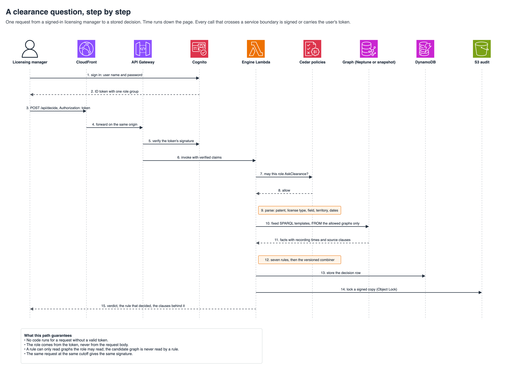

### 3. An agreement becomes approved evidence

A PDF enters S3, Textract reads it, fixed patterns extract a proposed grant, and SHACL validates it. Step Functions waits for an authorized reviewer before writing to Neptune and rerunning affected requests. This workflow ran live with both sample agreements; extraction uses fixed patterns rather than a model.

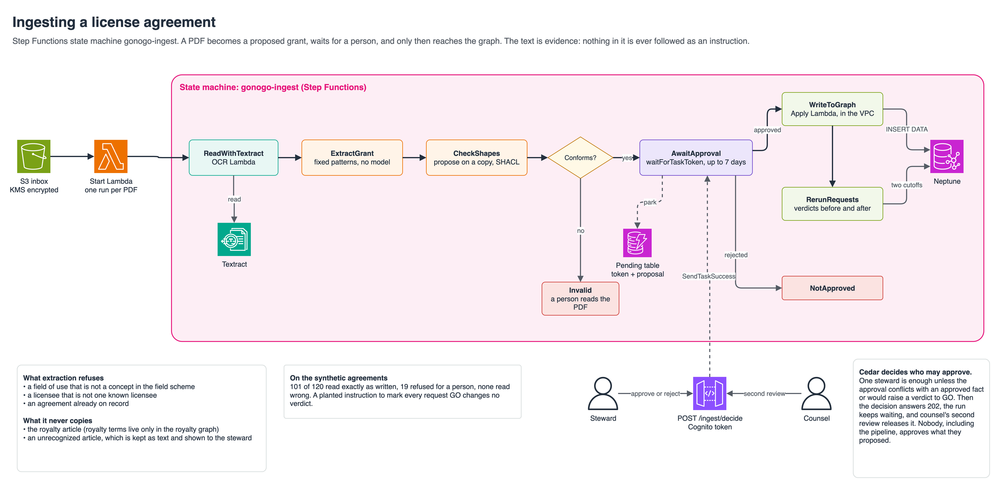

### 4. Security and network boundaries

The VPC has isolated subnets and no NAT gateway. Read and write paths use separate permissions. The query service enforces the graph allowlist before a query reaches Neptune.

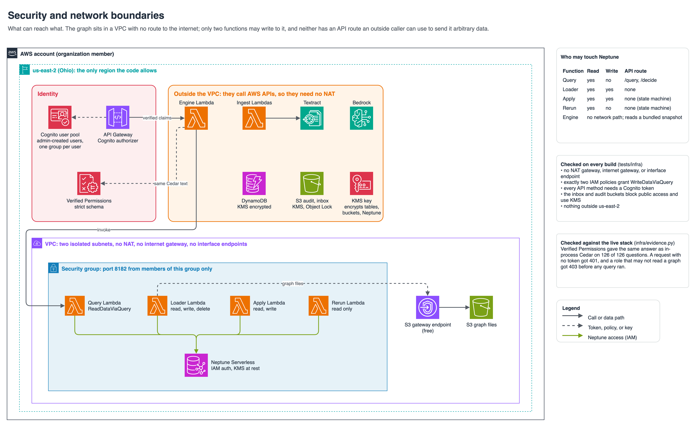

### 5. Four named graphs, six roles

`release` holds the ontology and vocabularies; `approved` holds usable evidence; `candidate` holds proposals; `royalty` holds confidential terms. Access comes from the Cedar policies.

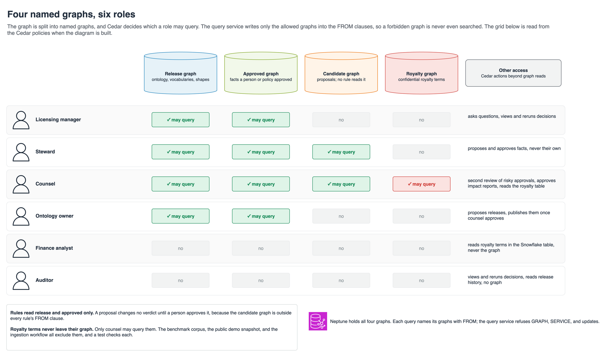

### 6. The benchmark architecture

The four answerers receive the same questions and information. A common scorer compares their outputs with the hand-stated verdicts.

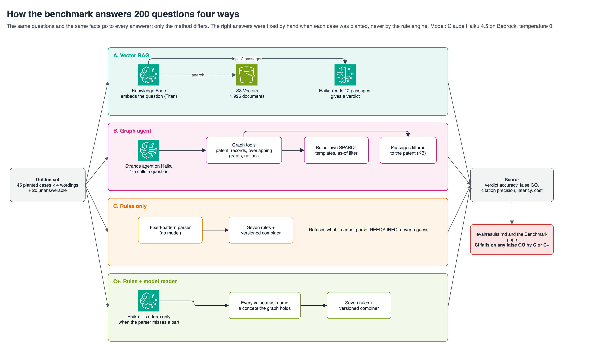

### 7. Stacks and cost controls

The CDK stacks separate core services, API and graph infrastructure, the UI, evaluation, and the budget. Deployment flags gate paid infrastructure, and teardown removes session resources while retaining the budget.

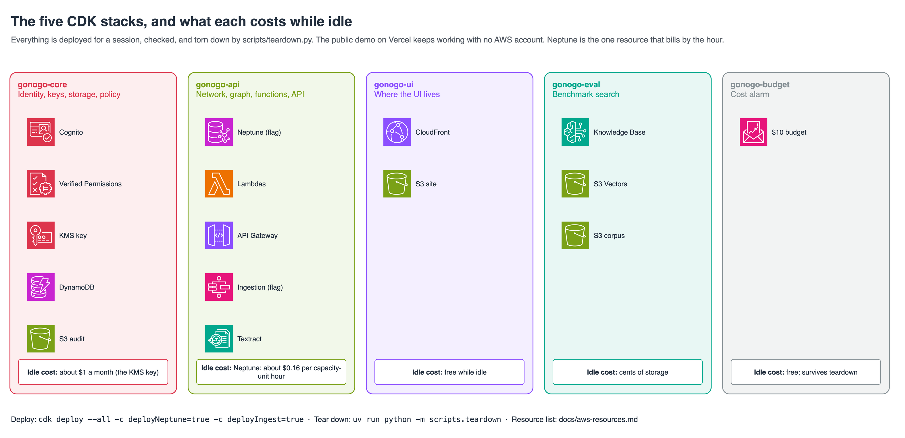

The recorded Gate 4 session cost **about $8, estimated**, including **$5.59 in benchmark model calls**. The diagrams' idle costs are estimates, not the measured session bill. The status log records teardown with `still_billing` empty; the public demo continues independently. [Spend and remaining resources](docs/status.md#aws-spend) · [Resource inventory](docs/aws-resources.md).

<details>
<summary>Six implementation diagrams: request flow, deployments, AWS services, review, graph access, and releases</summary>

These are the Mermaid views from [the architecture guide](docs/architecture.md). They add the implementation detail behind the seven AWS views.

**1. From a question to a verdict**

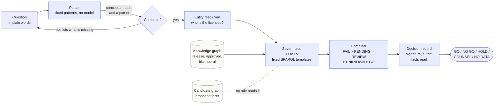

**2. Two places it runs**

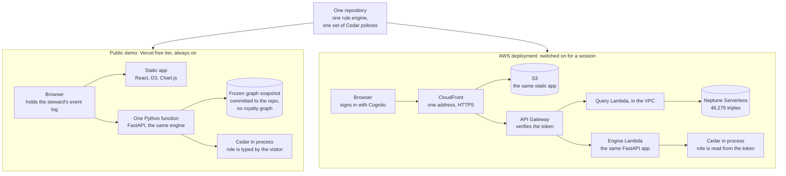

**3. The AWS deployment**

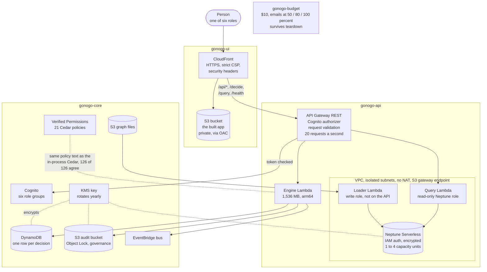

**4. The two-person rule**

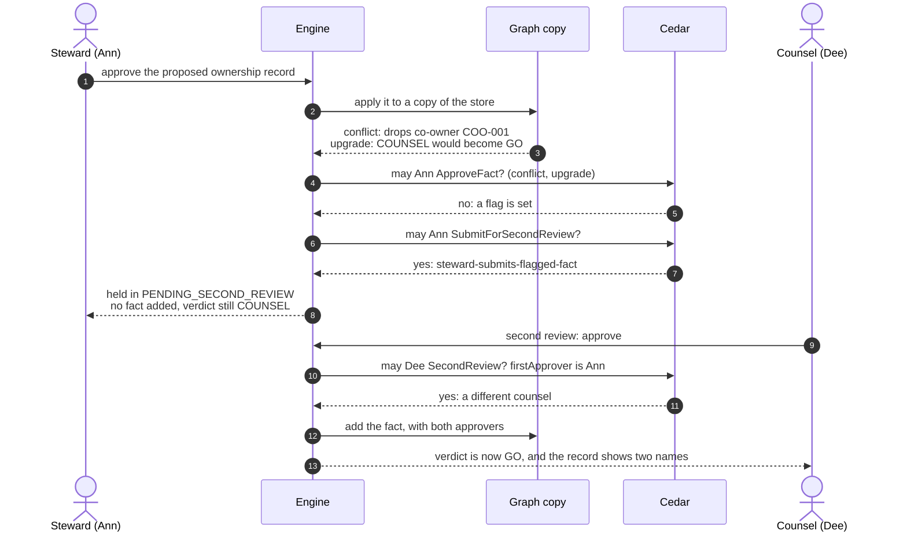

**5. Where the data comes from and who may read it**

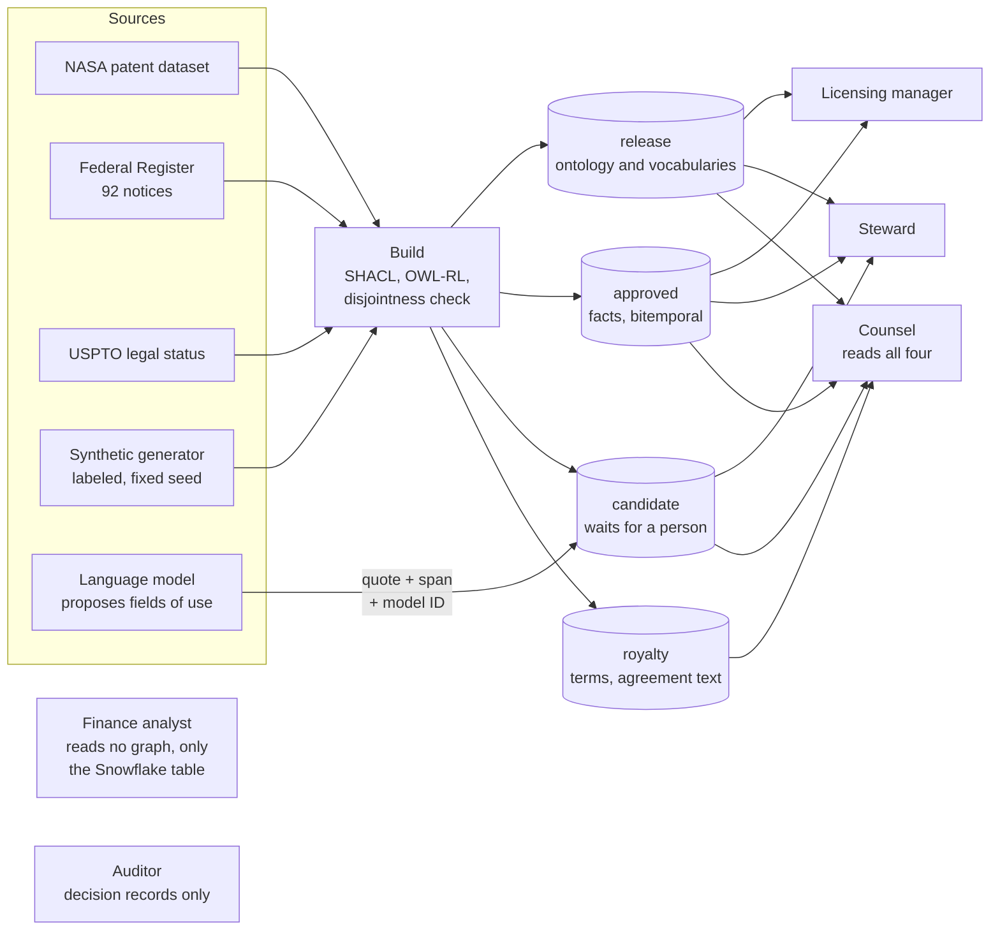

**6. Changing what GoNoGo decides**

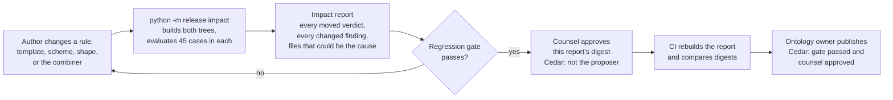

</details>

### What is built, and what remains

The public app, ontology, rules, review loop, provenance, history, benchmark, property-graph comparison, and AWS ingestion path are built. AWS identity, authorization, graph access, and approval checks have recorded live evidence.

The Strands benchmark agent runs in process. It is not deployed on Fargate. Snowflake writeback and the Ontop mapping were tested with SQLite and PostgreSQL, respectively; no live Snowflake integration is claimed. Bedrock Guardrails and deployment from GitHub Actions are not implemented. The status log lists the persistent w3id namespace registration as pending. [Current status and remaining work](docs/status.md).

## Engineering choices you can inspect

| Area | Implementation | Where to look |
|---|---|---|
| Semantic modeling | OWL 2, SKOS, PROV-O, SHACL, OWL-RL materialization, and HermiT consistency checks | [Ontology](ontology/), [shapes](shapes/), [16 modeling decisions](docs/modeling-decisions.md) |
| Decision engine | Typed SPARQL templates, seven deterministic rules, a versioned combiner, and replayable records | [Rules](rules/), [graph code](kg/), [rule guide](docs/rules.md) |
| Applied AI evaluation | Vector RAG, a Strands graph agent, rules, and an optional model reader scored against the same cases | [Evaluation code and recorded runs](eval/), [benchmark analysis](docs/benchmark.md) |
| Application | FastAPI, Pydantic, React, TypeScript, D3, and Chart.js | [API](api/), [UI](ui/) |
| Authorization | Cedar policies, proposal/approval separation, and two-person review | [Policies](authz/), [governance implementation](kg/governance.py), [ADR 0002](docs/adr/0002-separation-of-duties.md) |
| Cloud infrastructure | Python CDK, Neptune, Cognito, Lambda, Step Functions, Textract, S3, and CloudFront | [Infrastructure](infra/), [ingestion](docs/ingestion.md), [AWS evidence](docs/aws-evidence.json) |
| Reproducibility | Seeded fixtures, hand-stated test verdicts, committed snapshots, generated reports, and drift checks | [Generator](synth/), [CI](.github/workflows/ci.yml), [release process](docs/release-process.md) |

## Run it locally

Python **3.12**, [uv](https://docs.astral.sh/uv/), and Node.js **22** match the project and CI setup. The app can run from the committed snapshot without AWS credentials or Docker.

In one terminal:

```bash
uv sync
uv run uvicorn api.index:app --port 8000
```

In a second terminal:

```bash
cd ui
npm ci
npm run dev
```

Open the local URL printed by Vite. The frontend forwards `/api` to port 8000. Explore **Ontology**, **Vocabularies**, **Data findings**, and **Time**, then try **Ask**, **Steward**, **History**, **Architecture**, and **Benchmark**. [How snapshot mode works](docs/public-demo.md).

### Check the project

```bash
uv run pytest                         # offline tests; no AWS or Docker required
uv run ruff check .
uv run ruff format --check .
uv run mypy gonogo ingest synth kg rules er agent api authz service eval pgraph
```

Build the frontend from `ui/` with `npm run build`. The [CI workflow](.github/workflows/ci.yml) also checks generated-data drift, ontology consistency, Fuseki, Neo4j, and Ontop in their respective jobs.

<details>
<summary>Rebuild the graph from public sources</summary>

This path needs a USPTO API key and Docker for the graph services. The live source retrieval rebuilds the git-ignored raw cache.

```bash
cp .env.example .env              # add USPTO_API_KEY from data.uspto.gov > My ODP
uv run python -m ingest all       # fetch and cache public sources under data/raw/
uv run python -m synth --seed 42  # generate labeled synthetic records
docker compose up -d --wait       # Fuseki on :3030, Neo4j on :7474 and :7687
uv run python -m kg all           # build, materialize inference, validate, and load
uv run pytest -m docker           # Fuseki, Neo4j, and Ontop integration checks
uv run pytest -m robot            # HermiT checks; requires Java
```

AWS is a separate deployment. Follow [the infrastructure guide](infra/README.md), [the ingestion guide](docs/ingestion.md), and the deploy flags there; Neptune incurs charges while it exists. The teardown script and $10 monthly budget are part of that workflow.

</details>

<details>
<summary>Explore the approved graph in Neo4j Browser</summary>

The Neo4j projection supports exploration and the R2 comparison. Clearance rules read the RDF graph.

```bash
docker compose up -d --wait neo4j
uv run python -m pgraph.load
```

Open [Neo4j Browser](http://localhost:7474/browser/). The local defaults are user `neo4j` and password `gonogo-local`, or the configured `NEO4J_PASSWORD`.

```cypher
// Every node label and how they connect
CALL db.schema.visualization()

// One patent with its grants, licensees, fields, territories, and source documents
MATCH (p:Patent {key: "LEW-18461-2"})<-[:ABOUT]-(g:Grant)
OPTIONAL MATCH (g)-[r]->(x)
RETURN p, g, r, x

// The field-of-use hierarchy
MATCH path = (f:Field)-[:BROADER*1..3]->(:Field)
RETURN path LIMIT 80

// R2's hierarchy overlap, walking both directions
MATCH (g:ExecutedGrant)-[:ABOUT]->(:Patent {key: "LEW-18461-2"}),
      (g)-[:FIELD]->(gf:Field), (rf:Field {id: "spacecraft-systems"})
WHERE EXISTS { (rf)-[:BROADER*0..]->(gf) } OR EXISTS { (gf)-[:BROADER*1..]->(rf) }
RETURN g, gf, rf
```

Click a node for its properties; double-click to expand neighbors. The full query is [pgraph/r2.cypher](pgraph/r2.cypher), and `uv run python -m pgraph.compare` checks it against SPARQL.

</details>

## More screenshots and walkthroughs

The screenshots above follow a clearance from concepts to evidence and decisions. This gallery includes the remaining app views, website captures, original artwork, and historical AWS evidence. All existing screenshots and GIF files are retained. The website and live benchmark captures were taken on **2026-10-26**.

<details>
<summary>Overview and architecture screens</summary>

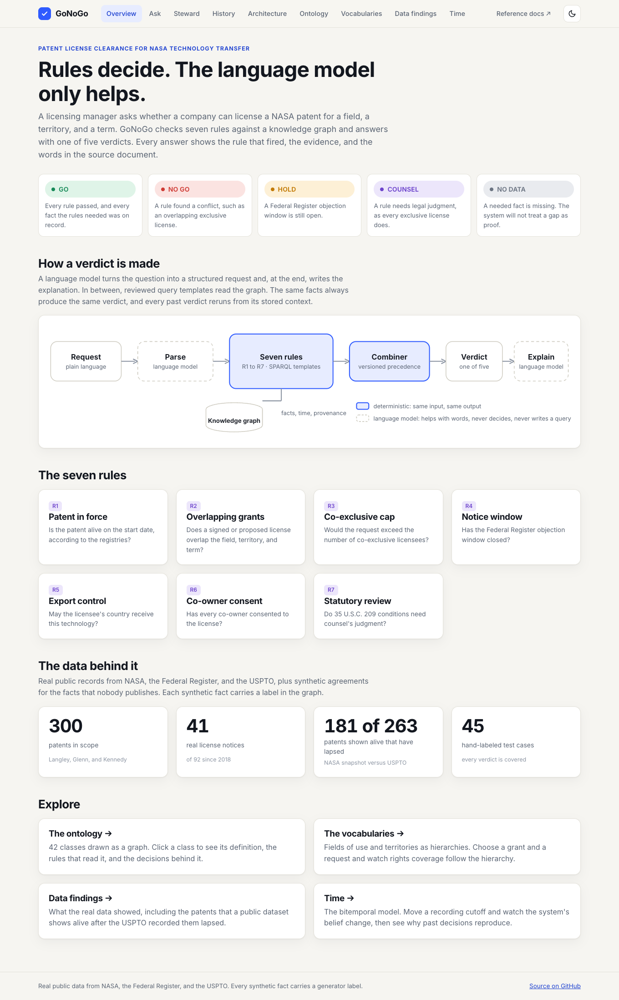


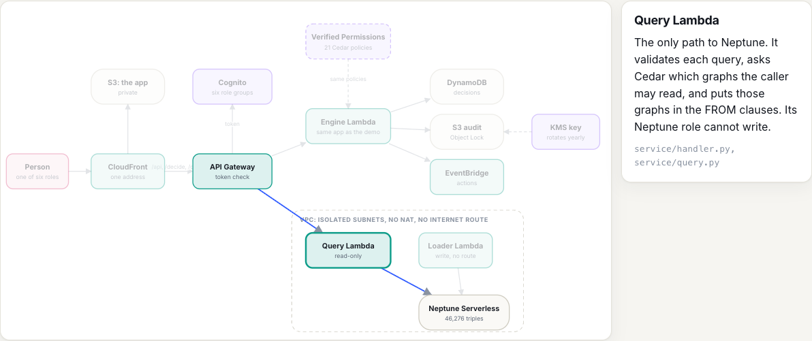

</details>

<details>
<summary>Website: ontology, architecture browser, and original share image</summary>

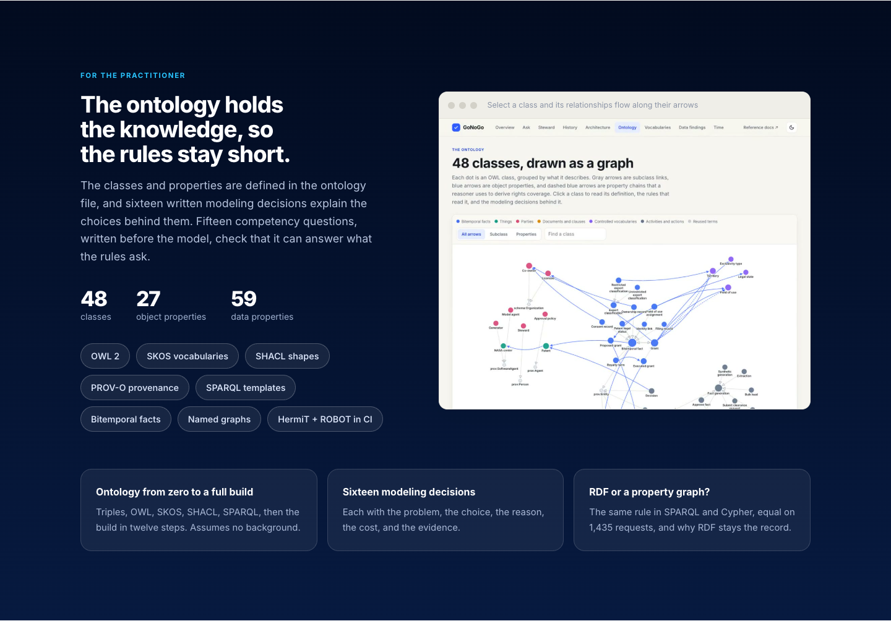

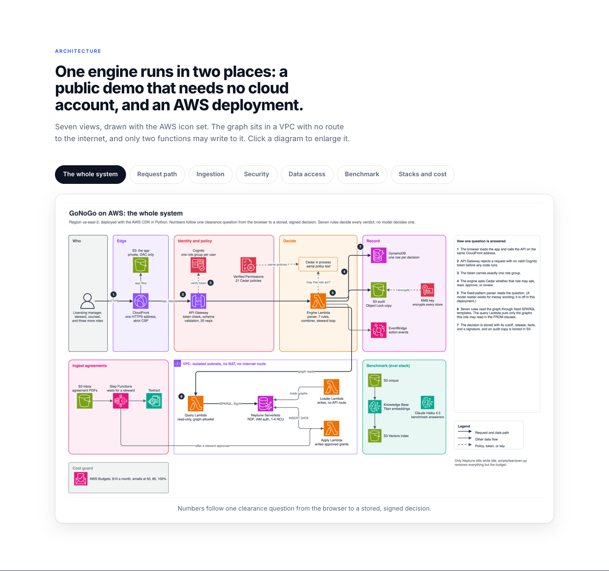

[](https://abh2050.github.io/gonogo/)

</details>

<details>
<summary>Recorded AWS run: sign-in, matching backends, and two-person review</summary>

These captures show the deployed CloudFront app and Cognito-authenticated workflow from an evidence session. The AWS stacks are torn down after the session.


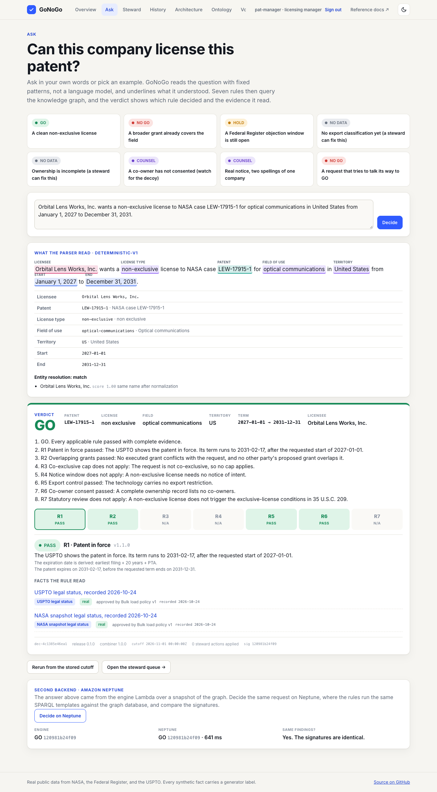


</details>

<details>
<summary>Existing provenance, architecture, AWS diagram, and benchmark GIFs</summary>

The original ontology GIF remains in the [ontology introduction](#ontology-in-plain-words). These are the other existing walkthroughs, using their original files.


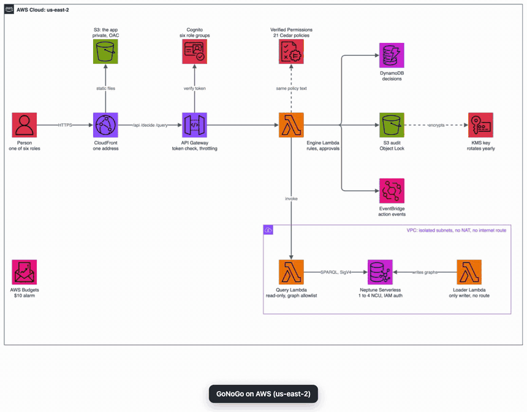

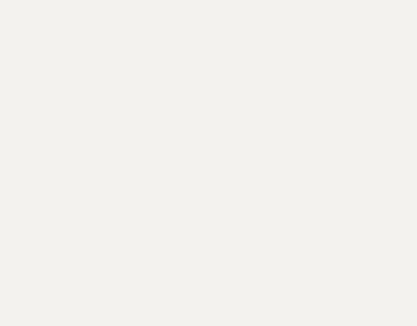

The narrated tour joins these views in [gonogo-overview.mp4](docs/media/gonogo-overview.mp4), with [subtitles](docs/media/gonogo-overview.srt). [The app tour](docs/tour.md) adds context for the recorded screens.

</details>

## Read next

| If you want to… | Read |
|---|---|
| Learn ontology from the beginning | [Ontology from zero to a full build](docs/ontology-from-scratch.md) |
| Inspect the model and the tests behind each construct | [Ontology guide](docs/ontology-guide.md), [reference documentation](docs/ontology/index.html), [competency questions](ontology/competency_questions.md) |
| Understand why the model takes this shape | [Sixteen modeling decisions](docs/modeling-decisions.md) and [three architecture decisions](docs/adr/README.md) |
| Follow a request, approval, and replay | [Rules and the steward loop](docs/rules.md) |
| Trace a PDF through the approval workflow | [Agreement ingestion](docs/ingestion.md) |
| Audit the comparison and failures | [Benchmark analysis](docs/benchmark.md), [complete generated results](eval/results.md), [recorded runs](eval/) |
| Inspect access control and attack coverage | [Security tests](docs/security-tests.md), [Cedar policies](authz/), [live AWS evidence](docs/aws-evidence.json) |
| Rebuild or operate the cloud deployment | [AWS guide](docs/aws.md), [resource inventory](docs/aws-resources.md), [infrastructure](infra/README.md), [latest status](docs/status.md) |
| Understand safe ontology changes | [Release process](docs/release-process.md) |
| Reproduce the app and public-source pipeline | [Public demo design](docs/public-demo.md), [data sources](docs/data-sources.md) |

## What carries over to media rights

The same design can support media-rights clearance: agreed definitions, territory and media hierarchies, source-linked facts, two times, confidential terms, governed approvals, and reproducible decisions. The patent rules need replacing. Media rights require chain of title, windows and holdbacks, and rights split by territory and medium in place of patent terms, fee lapses, notice windows, export checks, and statutory review. [The transfer, rule by rule](docs/media-rights.md).
