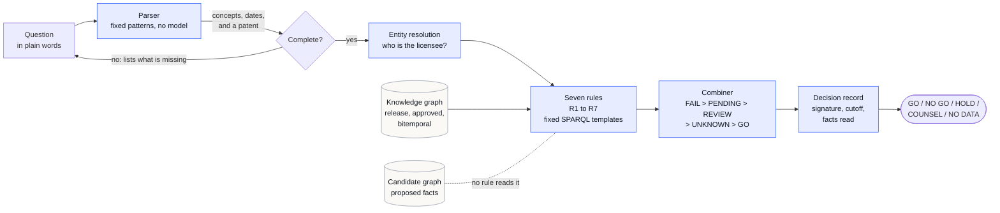
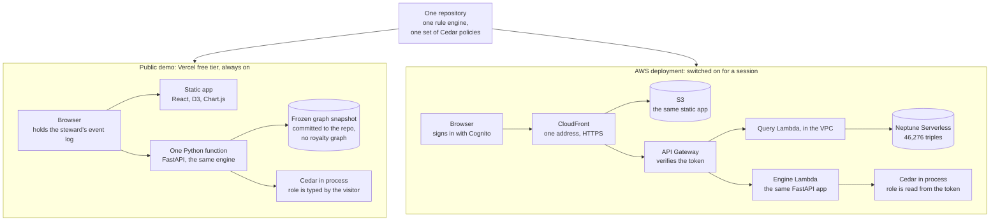
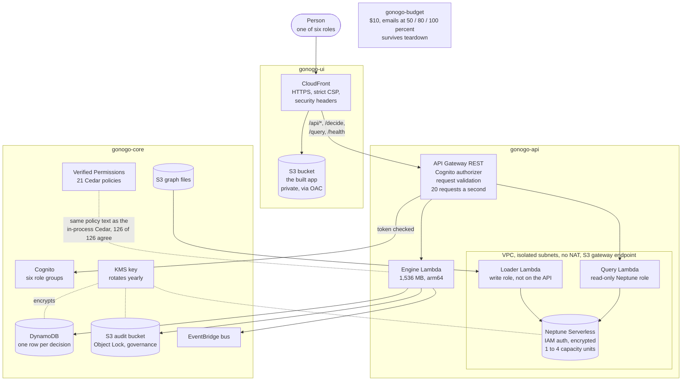
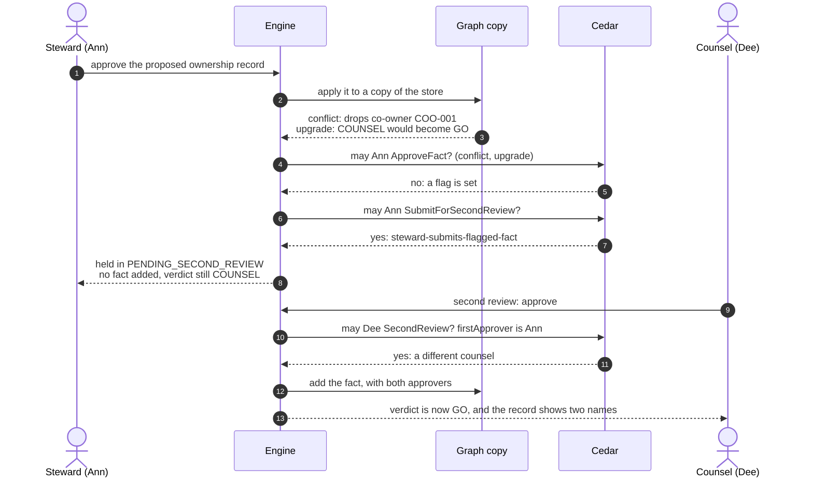
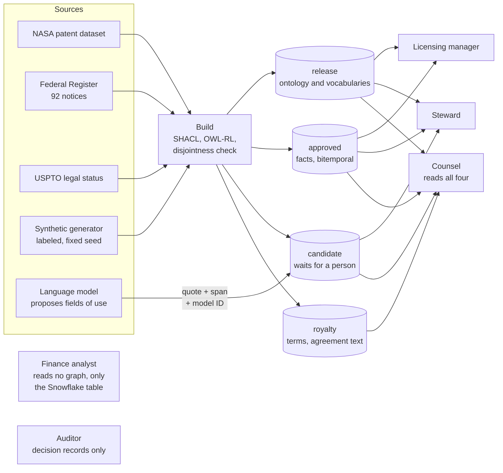
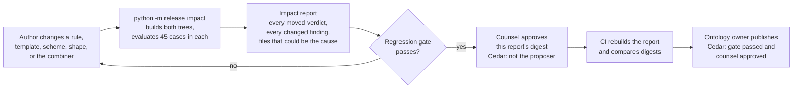

# Architecture

GoNoGo answers one question: can this company license this patent for this field, territory, and term. Six
diagrams show how it answers, where it runs, and who may touch what. GitHub draws them from the text. The same
pictures, with hover details, are on the [Architecture page](https://gonogo-livid.vercel.app/#/architecture) of the demo.

## 1. From a question to a verdict

Seven deterministic rules decide. A model never does.

## 2. Two places it runs

The Vercel demo costs nothing and stays up. The AWS deployment is the same engine on a graph database, behind real
identities, and is switched on for a session.

## 3. The AWS deployment

This is the first of seven draw.io views: the whole system, the request path, ingestion, security and network, data
and access, the benchmark, and stacks and cost. See [architecture/README.md](architecture/README.md).

106 resources in four stacks, listed one by one in [aws-resources.md](aws-resources.md). Everything is in
us-east-2. The VPC has no NAT gateway and no route to the internet.

## 4. The two-person rule

A wrong approval used to turn COUNSEL into GO. Now an approval that conflicts with the record, or that would
move a verdict to GO, waits for counsel.

## 5. Where the data comes from and who may read it

Royalty terms and agreement text live in their own graph, and Cedar decides which roles may read each graph.

## 6. Changing what GoNoGo decides

