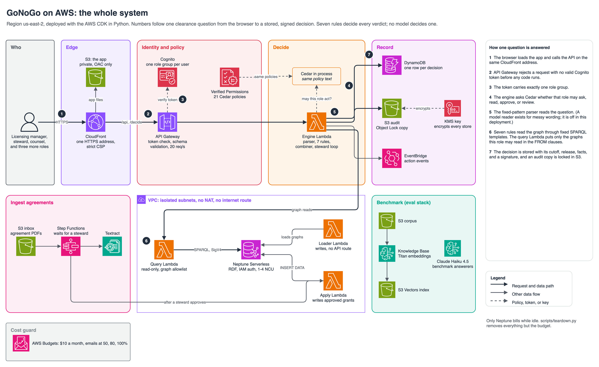

# The AWS deployment

The Vercel demo runs the rule engine over a frozen graph, and it keeps running with no AWS account. The AWS
deployment is a second path to the same engine, and its job is different: to show the engine running on Neptune
behind real identities, with the two-person rule held by Cedar and nothing readable that a role may not read. It
is deployed for a session, checked, and torn down. This page says what ran, what the checks found, and what is not
built.

This is the first of seven draw.io views: the whole system, the request path, ingestion, security and network, data
and access, the benchmark, and stacks and cost. See [architecture/README.md](architecture/README.md).

## What ran

| Piece | What it did in the session |
|---|---|
| Neptune Serverless | Held the four graphs, 46,276 triples, with IAM authentication and a customer key. Decisions ran as SPARQL through the same templates as the in-memory engine. |
| CloudFront and S3 | Where the UI lives on AWS. A private bucket holds the built app, and one CloudFront address serves it and passes `/api/*`, `/decide`, `/query`, and `/health` to the gateway, so the API needs no CORS. The app reads a `config.json` that the deploy writes, shows a sign-in page, and sends the token with each call. |
| Query Lambda, in the VPC | The only path to Neptune. It validates each query, asks Cedar which graphs the caller may read, and puts those graphs in the `FROM` clauses. It holds read-only Neptune permissions. |
| Loader Lambda, in the VPC | Wrote the graphs to Neptune. It alone holds write permissions. |
| Engine Lambda | The FastAPI app that serves the demo, with the caller's identity taken from the token. It runs the steward loop, writes each decision to DynamoDB and to an Object Lock bucket, and publishes an event. |
| API Gateway | A Cognito authorizer on every method, request validation on the two POST routes, and throttling at 20 requests a second. |
| Cognito | Six groups, one per role. A user in more than one group is refused. |
| Verified Permissions | The 21 Cedar policies, validated in strict mode against a schema. |
| KMS, S3, DynamoDB | Encryption at rest, an audit bucket in governance-mode Object Lock, and a point-in-time-recovery table. |

Every resource, with its cost while idle, is in [aws-resources.md](aws-resources.md), and the pictures are in
[architecture.md](architecture.md).

The VPC has no NAT gateway, no internet gateway, and no interface endpoint. The Lambdas inside it reach Neptune
and S3 and nothing else.

## What the checks found

`infra/evidence.py` creates one Cognito user per role and runs these through API Gateway with real tokens. All 11
passed on the final run, and the results are in [aws-evidence.json](aws-evidence.json).

| Check | Result |
|---|---|
| Neptune holds the graphs | 46,276 triples loaded in 26 seconds, equal to the local counts graph by graph |
| Verified Permissions agrees with local Cedar | 126 of 126 answers match, across 21 actions and 6 roles |
| No token, no service | 401 |
| Leakage, every role | 500 queries across 8 users: 382 refused, 0 returned royalty text, and the deployment agreed with the local service on every one |
| Bad bodies | An oversize query, an extra field, and an empty body each get a 400 from the gateway before any Lambda runs |
| Decisions on Neptune | 43 of 43 signatures equal the in-memory signatures |
| Two-person rule with two people | The decoy approval waits (COUNSEL stays), a second steward is refused, the first approver is refused, a different counsel approves, and the verdict becomes GO |
| Identity | A body that claims to be counsel is ignored in favor of the token |
| Reads | A licensing manager cannot read the steward queue, and finance and auditors cannot ask a question |
| Audit | Each of the three permitted decisions is in DynamoDB and in a governance-locked S3 object |

Latency, measured from a laptop through the gateway: a decision on Neptune took 573 ms at the median and 897 ms at
the 95th percentile, against 156 and 337 ms in memory. The engine Lambda took about 1.2 s at the median, and most of
that is the gateway, the DynamoDB write, and the S3 write that each decision makes.

## What is not built

- **The agent on Fargate.** The PRD runs a Strands agent on ECS Fargate. Gate 3 has no agent: the parser is
  deterministic, and the one model call, field-of-use extraction, runs from a script.
- **The ingestion workflow.** Textract, Step Functions with a steward callback, and the Bedrock structured
  extraction of agreements are not built. Approvals run through the engine Lambda instead.
- **Guardrails and a model-written explanation.** No model writes an explanation, so there is nothing for a
  guardrail or a citation checker to check yet.
- **Ontop on Fargate and a live Snowflake account.** Ontop ran in Docker against PostgreSQL, and the writeback ran
  against SQLite. See [mappings/README.md](../mappings/README.md).
- **Deployment from CI.** Deploys come from a laptop. A GitHub Actions role with OIDC is not set up.
- **MFA, WAF, CloudTrail data events, and a second Neptune replica.** Cognito MFA is off because the evidence run
  signs in with scripted users. The rest are production hardening that a portfolio session does not need.

## What went wrong on the way

- **Listing a Claude model is not permission to call it.** The account lists Sonnet 5.5, and calling it returns
  access denied. Discovery now sends a one-token request to each candidate and takes the newest that answers.
  Today that is Sonnet 4.6.
- **Verified Permissions needs a namespace.** It rejected the schema with "Invalid input" and no detail. Adding
  `GoNoGo::` to every type fixed it. `authz/avp.py` does this on the AWS side only, and a test checks that the
  namespaced policies decide the same as the originals.
- **The first teardown failed.** It sent the Object Lock bypass flag to a bucket that has no Object Lock, and S3
  refused. The script now asks each bucket first, and a test covers both cases.
- **The teardown report missed a KMS key.** It looked for a description the key never had. It now finds keys by tag.
- **A tag budget is impossible here.** This account is linked to an organization and cannot use cost allocation
  tags, and another project's spend already exceeds $10 a month. The budget filters on the eight AWS services that
  only GoNoGo uses. Bedrock is outside it, so Bedrock spend is checked by hand.

## Cost and teardown

I expected the session to cost under $2 and did not measure it, because Cost Explorer lags a day. The Neptune
cluster was up for about 80 minutes at its 1 NCU minimum. Run `uv run python scripts/aws_spend.py 2026-10-25
2026-10-27` for the measured figure. The Bedrock calls come to about $0.68 by token count: 129,848 input tokens
and 3,433 output tokens for the field-of-use run, and 69,597 and 1,800 for the injection measurement, priced at
$3 and $15 per million tokens.

`scripts/teardown.py` removes both stacks and reports what is left. After this session it left three things:

| Left behind | Why |
|---|---|
| The `gonogo-budget` stack and its budget | Free. It watches for spend that something else forgot. |
| One KMS key, pending deletion until 2026-11-01 | KMS allows a seven-day wait at the least, and a key waiting for deletion is not billed. |

Nothing that bills remains, and [aws-teardown.json](aws-teardown.json) records the run.
