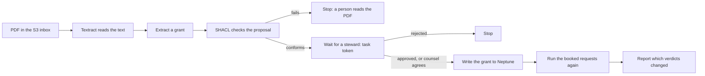

# The agreement ingestion workflow

A new license agreement arrives as a PDF. This workflow reads it, turns it into a proposed grant, waits for a
person, writes the grant to the graph once a person approves it, and runs every booked request on the affected
patent again, so a steward sees which verdicts the agreement changed.

It is the same loop that the Steward page runs for a single fact, with a document at the front.



## What each step does

| Step | Where | What it does |
|---|---|---|
| Inbox | S3 bucket, encrypted | A PDF that lands here starts one execution of the state machine. |
| Read | `ocr_handler`, Textract | Reads the PDF's lines. Agreements are a few pages, so the Lambda waits for the job. |
| Extract | `extract_handler`, `service/ingest.py` | Splits the text into articles and reads a grant out of them with fixed patterns. Every value must name a concept, patent, or licensee that the graph holds, or the step stops and says what is missing. |
| Check | `check_handler` | Proposes the grant on a copy of the graph. SHACL runs inside the proposal. |
| Wait | `await_handler`, Step Functions `waitForTaskToken` | Parks the proposal in a table with its task token. The execution sleeps, at no cost, for up to a week. |
| Decide | `decide_handler`, `POST /ingest/decide` | A signed-in person approves, rejects, or gives a second review. Cedar decides who may, and the two-person rule applies. |
| Write | `apply_handler`, in the VPC | Replays the proposal and the approval and sends the new triples to Neptune. It is the only step besides the loader that may write there. |
| Rerun | `rerun_handler`, in the VPC | Runs each booked request on the patent twice on Neptune, once with records up to one second before the approval and once with it, and reports what changed. |

## What the extractor will not do

The extractor does not use a model, and it does not trust the text.

- **A planted instruction is only text.** An article it does not recognize is kept as an "other" clause, shown to
  the steward, and never acted on. The second sample agreement carries a line telling an automated reviewer to mark
  every request GO. The test `test_a_planted_instruction_is_kept_as_text_and_changes_nothing` approves that grant
  and checks that no verdict moves.
- **It refuses what it cannot read.** Of the 120 synthetic agreements, it reads 101 exactly as the generator wrote
  them and refuses 19: 17 whose field of use is free text that is not a concept in the field scheme, and 2 whose
  licensee name is just "L.L.C.". A refusal goes to a person. It never guesses. A test requires that every
  agreement is either read exactly or refused.
- **It never copies the royalty article.** Royalty terms live only in the royalty graph. The extractor drops
  that article, and a test checks that the words never reach the approved or candidate graphs.
- **It proposes as a pipeline, never as a person.** The proposer is "Ingestion pipeline". Nobody approves what
  they proposed, so the pipeline cannot approve its own work, and a test checks it.
- **A grant adds, and replaces nothing.** Approving another licensee's exclusive grant leaves the earlier grants
  in place.

## When an approval waits for counsel

The workflow uses the same two-person rule as the Steward page (ADR 0002). One steward is enough unless the approval
conflicts with a fact that is already approved, or it would move a verdict from COUNSEL or NO GO up to GO.

Neither sample triggers that. The first sample agreement grants an exclusive license on a patent that has a
non-exclusive request booked against it. Approving it moves that request from GO to NO GO. That lowers the risk, so
one steward may approve. The second sample changes no verdict. When an agreement does need counsel, `decide_handler`
answers 202 with `pending_second_review`, the execution keeps waiting, and counsel's `second_review` releases it.
`infra/ingest_demo.py` follows that branch when it happens.

## Run it yourself

The state machine needs the AWS stack, because Textract and Neptune are AWS services. Everything except those two
runs locally.

```bash
# Locally: extraction, the proposal, the approval, and the verdicts it changes. No AWS.
uv run python -m scripts.ingest_samples        # writes data/ingest/AGR-0901.pdf and AGR-0902.pdf
uv run pytest tests/service/test_ingest.py

# On AWS (about an hour of Neptune, a few dollars):
cd infra && npx aws-cdk deploy gonogo-core gonogo-api -c deployNeptune=true -c deployIngest=true
uv run python infra/evidence.py                # loads the graph into Neptune
uv run python infra/ingest_demo.py             # runs both samples through the state machine
uv run python -m scripts.teardown
```

The run's record is `docs/ingestion-run.json`.
