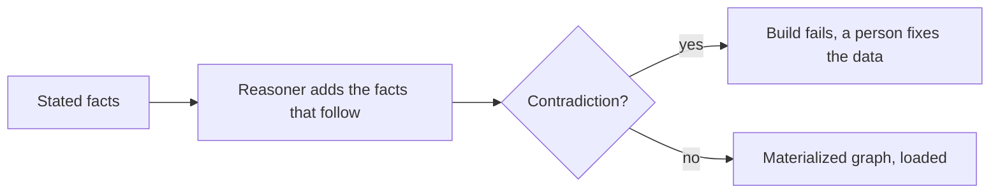
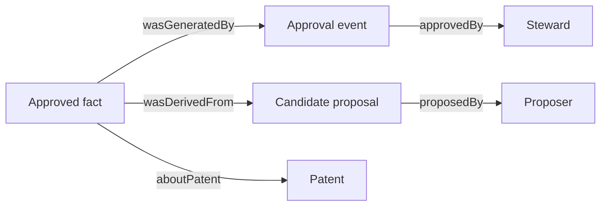
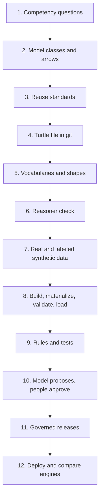

# Ontology from zero to a full build

This guide is for someone who has never heard the word "ontology". It starts with a spreadsheet and ends with a
system that decides patent license questions and can show its work. Every example comes from this repository, so
you can open the file and check it.

If you already know OWL and SPARQL, skip to [the finished model](ontology-guide.md) and the
[modeling decisions](modeling-decisions.md).

**How to read it.** Chapters 1 to 4 need no background. Chapters 5 to 8 add the ideas that trip up newcomers.
Chapters 9 to 11 are the build, in the order we did it. A glossary and a few exercises close the guide.

---

## 1. The problem: facts that do not agree on what words mean

A licensing manager at a NASA center gets a request: "Can we license patent X to Company Y, for use in aviation,
in Europe, exclusively, from next March?"

To answer, someone must check several facts:

- Is the patent still in force?
- Does a signed license already cover the same field and territory?
- Did the government publish a notice that is still open for objections?
- Is the patent export controlled?
- Does every co-owner agree?

These facts live in different places: a spreadsheet of patents, scanned agreements, Federal Register notices,
a legal-status feed. Each source uses its own words. One calls a company "Acme Corp." and another "ACME
Corporation". One says "aviation" and another says "aeronautics".

A person can reconcile this. A program cannot, unless the meaning of each word is written down in a form that a
program can read. **That written-down meaning is an ontology.**

## 2. What an ontology is, in plain words

An ontology is a shared dictionary plus a set of rules about how the words relate. It answers three questions:

1. **What kinds of things exist?** (Patent, Grant, Licensee, Notice.)
2. **How can they relate?** (A grant is *about* a patent. A grant has a *licensee*.)
3. **What must be true, and what follows?** (Every executed grant has exactly one exclusivity type. An executed
   grant is never also a proposed grant.)

A database schema also names kinds of things. The difference is that an ontology is:

- **Shared and public.** Anyone can read the definitions and reuse them. GoNoGo's lives at
  `https://w3id.org/gonogo/ontology#`.
- **Machine-readable logic.** A program called a reasoner can derive new facts and spot contradictions.
- **Open to extension.** You can add a new kind of fact without rebuilding tables.

A good everyday comparison is a library catalog. The catalog says what a "book", an "author", and a "subject" are,
and how they connect. Two libraries that follow the same catalog rules can share records.

## 3. Facts as triples

All the data in an ontology system is written as **triples**: subject, predicate, object. It reads like a short
sentence.

```text
Grant-17   isAbout    Patent-9297368
Grant-17   licensee   Acme-Corp
Grant-17   territory  Europe
```

Each part is a name that is unique worldwide, called an **IRI** (it looks like a web address). That uniqueness is
what lets two datasets agree that they mean the same thing. Short forms use a **prefix**: `gng:Grant` means
`https://w3id.org/gonogo/ontology#Grant`.

A pile of triples is a **graph**: things are the dots, predicates are the arrows. This is the **RDF** model, and
the standard file format you will see here is **Turtle** (`.ttl`).

> See it: open the **Ontology** page in the [live demo](https://gonogo-livid.vercel.app/#/ontology). Each dot is
> a class. Click one and its arrows light up.

## 4. Classes, properties, and what a reasoner adds

**Classes** are kinds of things. **Properties** are the arrows between things. **OWL** is the language for
describing both with logic. Here is a real piece of GoNoGo's ontology:

```turtle
gng:ExecutedGrant a owl:Class ;
    rdfs:subClassOf gng:Grant ,
        [ a owl:Restriction ; owl:onProperty gng:licensee ; owl:someValuesFrom gng:Licensee ] ,
        [ a owl:Restriction ; owl:onProperty gng:aboutPatent ; owl:someValuesFrom gng:Patent ] ;
    owl:disjointWith gng:ProposedGrant ;
    skos:definition "A grant that a signed agreement creates."@en .
```

Read it line by line:

- `gng:ExecutedGrant` is a class.
- It is a **subclass** of `gng:Grant`. Anything that is an executed grant is also a grant.
- It must have a licensee that is a Licensee and be about a Patent (the `Restriction` blocks).
- It is **disjoint** with `gng:ProposedGrant`. Nothing can be both.

### What the reasoner does

A **reasoner** (GoNoGo uses `owlrl` inside the build and HermiT in CI) applies these statements as logic:

- If you say `Grant-17` is an `ExecutedGrant`, it adds "`Grant-17` is a `Grant`".
- If a record is stated as both executed and proposed, it reports a contradiction.

GoNoGo runs the reasoner **before** loading the graph, writes the result down (this is called materializing), and
checks it. The decision engine then queries plain facts and never waits on a reasoner. That choice is
[MD13](modeling-decisions.md).



## 5. The open world: a missing fact is not a "no"

Most programmers think in a **closed world**: if the database has no row, the answer is no. Ontologies use the
**open world assumption**: if a fact is not stated, you do not know.

This matters for patent licensing. If the graph has no co-owner record for a patent, that does **not** mean the
patent has no co-owners. It means the system does not know. So GoNoGo's rule R6 returns `UNKNOWN`, and the verdict
is `NO DATA`, instead of a confident `GO`.

To say "there are no co-owners", someone must record that as a fact: an ownership record that is complete and
lists zero co-owners. GoNoGo treats a **negative fact as a fact** ([MD6](modeling-decisions.md)).

Closed-world reasoning would approve patents that nobody checked. The open world keeps the system honest.

## 6. Classes versus controlled vocabularies (SKOS)

Some words are not kinds of things. "Aviation" and "Aeronautics" are not classes of objects. They are **concepts**
in a hierarchy of fields of use: "Aeronautics" is broader than "Unmanned aircraft".

For these, GoNoGo uses **SKOS**, a small standard for vocabularies with `broader` and `narrower` links, labels,
and alternate spellings. You will find them in [ontology/schemes/](../ontology/schemes/): fields of use,
territories, exclusivity types, and legal states.

Why not make each field a subclass in OWL? Because a reasoner cannot see inside a concept, and a field hierarchy
changes more often than the model does. The cost is that GoNoGo adds the coverage rule itself: a grant for a broad
field covers a request for a narrower one. That is [MD3 and MD4](modeling-decisions.md).

## 7. Checking data: SHACL is not the reasoner

People mix up two jobs:

| Job | Tool | Question it answers |
|---|---|---|
| **Reasoning** | OWL reasoner | "Given what is stated, what else must be true? Is anything contradictory?" |
| **Validation** | SHACL | "Does this data have the shape we require? Is a required value missing?" |

Under the open world assumption, a missing required value is not a contradiction, so the reasoner stays silent.
SHACL checks it anyway. In GoNoGo, `shapes/gonogo-shapes.ttl` says things like "every patent needs a case number"
and "every approved fact needs an approver". The build fails if a shape is broken.

A third job belongs to neither: **the decision**. The seven rules (R1 to R7) are plain queries. Keeping the three
jobs apart is [MD12](modeling-decisions.md).

## 8. Time and provenance: a fact is more than a statement

A real fact has a history. GoNoGo records two kinds of time on each fact:

- **When it holds in the world.** A license is valid from one date to another.
- **When the system learned it.** A record entered on a date, and a later record may correct it.

That second axis is what lets the system answer "what would we have said on 1 March, with what we knew then?" and
get the same answer every time. This is a **bitemporal** model ([MD7](modeling-decisions.md)).

Each fact also records **where it came from**, using **PROV-O**, the standard vocabulary for provenance: which
action created it, who approved it, which proposal it was copied from, and which document clause supports it.
Synthetic facts say so. Open the **Provenance** walk in the [tour](tour.md) to follow one approved fact back to
its proposer.



## 9. Asking questions: SPARQL

**SPARQL** is the query language for graphs. A query describes a pattern, and the engine finds every match. This
is the first of GoNoGo's seven rules, trimmed:

```sparql
SELECT ?status ?expiration ?recorded
WHERE {
  ?status a gng:PatentLegalStatus ;
          gng:aboutPatent <patent-iri> ;
          gng:recordedAt ?recorded .
  OPTIONAL { ?status gng:expirationDate ?expiration }
}
ORDER BY DESC(?recorded)
```

Read it as: "find every legal-status fact about this patent, newest first, with its expiration date if it has one."

Two rules keep this safe. The decision engine fills **fixed templates** with typed values, so a question typed by
a person can never become query text. And a language model **never writes a query that decides a verdict**. The
real templates are in [rules/templates/](../rules/templates/).

### Named graphs

Facts live in **named graphs**, which are labeled bins. GoNoGo keeps the released ontology, approved facts,
proposed candidates, and royalty terms in different graphs. A rule reads only the graphs it should. Royalty terms
never leave their own graph, and a person only reads the graphs their role may see. That is enforced with Cedar
policies ([docs/security-tests.md](security-tests.md)).

## 10. The build, step by step

This is the order GoNoGo was built in. You can reuse it for any ontology project.

### Step 1. Write the questions first

Before drawing anything, list the questions the system must answer. These are **competency questions**.
GoNoGo has 15 in [ontology/competency_questions.md](../ontology/competency_questions.md), each an executable query
with hand-checked answers in `tests/cq/`. A class or property that no question needs is cut.

### Step 2. Sketch the classes and arrows

Draw it on paper. What are the nouns? What connects them? Decide for each noun whether it is a **class**, a
**concept in a vocabulary**, or just a **value** on something else. The result is the diagram on the
[ontology guide](ontology-guide.md).

### Step 3. Reuse before you invent

Align with standards. GoNoGo borrows PROV-O (provenance), SKOS (vocabularies), Dublin Core (titles), and
schema.org (company names), and records how its classes line up with an upper ontology in
[ADR 0001](adr/0001-upper-ontology-alignment.md).

### Step 4. Write it in a file, not a tool

The ontology is a text file, [ontology/gonogo.ttl](../ontology/gonogo.ttl), kept in version control. Protégé is a
good editor for exploring it. The file stays the source of truth, so a change is a reviewable diff.

### Step 5. Add the vocabularies and shapes

Write the SKOS schemes for fields, territories, exclusivity, and legal states. Then write the SHACL shapes. Run
them against sample data **before** any real data exists.

### Step 6. Test with a reasoner

Run ROBOT with HermiT to check that the ontology is consistent and that no class is unsatisfiable:

```bash
uv run pytest -m robot     # needs Java
```

### Step 7. Bring in real data, and label what you invent

GoNoGo ingests public NASA patent data and Federal Register notices. Where real data is missing, a seeded
generator writes synthetic records, and **every synthetic record is labeled as synthetic** and traced to the
generator. A reader can always tell a real fact from a made-up one.

```bash
uv run python -m ingest all
uv run python -m synth --seed 42
```

### Step 8. Build the graph and gate it

One command builds the graph, materializes inference, runs SHACL, and loads a triple store:

```bash
docker compose up -d --wait
uv run python -m kg all
```

### Step 9. Write the rules, and prove each with a test

Seven rules (R1 to R7) turn graph facts into one of six statuses. A **versioned combiner** turns the statuses into
one of five verdicts: GO, NO GO, HOLD, COUNSEL, or NO DATA. Each rule has hand-computed expected answers.
See [docs/rules.md](rules.md).

### Step 10. Let a model help, but never decide

A language model may read text and **propose** a fact, for example a field of use found in an agreement. The
proposal goes to a **candidate graph** that no rule reads. A person must approve it. A fact that would move a
verdict to GO, or that conflicts with an approved fact, needs a **second** person. The model never writes the
verdict ([MD14, MD15](modeling-decisions.md), [ADR 0002](adr/0002-separation-of-duties.md)).

### Step 11. Make it governable

Changes to the ontology ship as a **release**: a versioned bundle, an **impact report** that shows which verdicts
would change, and a counsel approval tied to that report ([docs/release-process.md](release-process.md)).

### Step 12. Deploy it twice

The same engine runs in a public demo (Vercel) and on AWS (CloudFront, API Gateway, Cognito, Lambda, Neptune).
Decisions are identical on Fuseki and Neptune, which is checked with real requests. See
[docs/aws.md](aws.md) and the [AWS diagrams](architecture/README.md).



## 11. Tools you will meet

| Tool | What it is for | Where it appears here |
|---|---|---|
| **Protégé** | Desktop editor for ontologies | Exploring `ontology/gonogo.ttl` |
| **ROBOT** | Command-line ontology checks and edits | `uv run pytest -m robot` |
| **HermiT** | A reasoner that finds contradictions | CI job on every push |
| **rdflib, owlrl** | Python libraries for RDF and OWL inference | The graph build |
| **pySHACL** | SHACL validation in Python | The build gate |
| **Apache Jena Fuseki** | Triple store with a SPARQL endpoint | Local and CI |
| **Amazon Neptune** | Managed graph database | The AWS deployment |
| **Ontop** | Shows a SQL table as a virtual graph (R2RML) | Verdict table for finance |
| **Cedar** | Policy language for who may do what | Every role and action |

## 12. Mistakes to avoid

1. **Starting with the tool.** Write the questions first.
2. **Treating a missing fact as false.** Use the open world on purpose, and record negative facts.
3. **Turning every word into a class.** Vocabularies exist for a reason.
4. **Letting a model decide.** Let it propose, and let people and fixed rules decide.
5. **Mixing real and invented data without a label.** Mark every synthetic fact.
6. **Changing the model with no test.** A change that moves an answer should fail a test.
7. **Giving the reasoner a job it cannot do.** Validation is SHACL. Decisions are rules.

## 13. Glossary

| Term | Meaning |
|---|---|
| Ontology | A shared, machine-readable definition of kinds of things and how they relate |
| Triple | One fact: subject, predicate, object |
| IRI | A globally unique name for a thing, written like a web address |
| RDF | The graph model that stores triples |
| Turtle | A readable text format for RDF |
| OWL | A language for logic about classes and properties |
| Reasoner | A program that derives facts from stated ones and finds contradictions |
| SKOS | A standard for vocabularies with broader and narrower terms |
| SHACL | A language for checking that data has the required shape |
| SPARQL | The query language for graphs |
| Named graph | A labeled set of triples |
| Open world | A fact that is not stated is unknown, not false |
| Bitemporal | Each fact records when it holds and when the system learned it |
| PROV-O | A standard vocabulary for where facts came from |
| Competency question | A question the ontology must let a user answer |
| Materialize | Compute the inferred facts once and store them |

## 14. Exercises

1. Open the Ontology page. Find `Executed grant`. Which two classes is it related to by "subclass" and
   "disjoint with"?
2. In [ontology/schemes/fields.ttl](../ontology/schemes/fields.ttl), find a broader field and a narrower one.
   Which request would a grant on the broader field cover?
3. Ask in the demo: "No export classification yet". Why is the verdict `NO DATA` and not `GO`? Approve the proposed
   fact on the Steward page and watch rule R5 change.
4. Run `uv run pytest tests/cq -q`. Change one expected answer in a case file and see which test fails.
5. Add a new SKOS concept under a field. Which test or shape tells you the build still passes?
6. Follow the provenance walk for an approved fact. Name each hop and the PROV-O term it uses.

## Where to go next

- [The model on one page](ontology-guide.md), with each construct and the test that proves it
- [Modeling decisions](modeling-decisions.md), the reasons behind each choice
- [The architecture](architecture.md) and the [AWS diagrams](architecture/README.md)
- [The tour](tour.md), with screenshots and the walks
