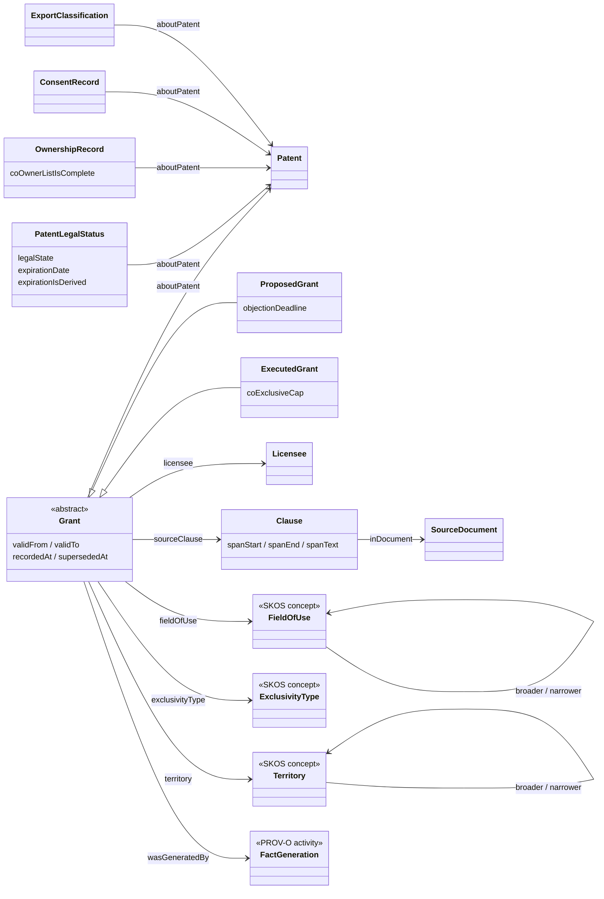

# The GoNoGo ontology, explained

This guide shows what the ontology contains, why each part is there, and how to check that it works. Every claim
points at a file or a test, so a reader can verify it without taking the author's word.

## The problem the ontology solves

A licensing manager at a NASA center gets a request: a company wants a license to a patent for one field, in one
territory, for some years. Before the manager can say yes, several facts must line up. The patent must be alive.
No signed license may overlap the request. No export rule may block the company. Every co-owner must have
consented. These facts sit in different documents, and a missing fact is as dangerous as a conflicting one.

An ontology gives those facts one shared meaning. A rule engine can then ask precise questions of them, a
reasoner can check them, and a person can follow any answer back to the words in a document.

## The model on one page



`ProposedGrant` comes from a Federal Register notice. `ExecutedGrant` comes from a signed agreement. The four
fact classes at the bottom left (`PatentLegalStatus`, `OwnershipRecord`, `ConsentRecord`,
`ExportClassification`) are also bitemporal facts, with the same time properties and provenance as `Grant`. The
diagram leaves out the shared superclass to stay readable. The [reference documentation](ontology/index.html)
lists all 42 classes and 69 properties, and [the interactive explorer](../ui/README.md) draws the whole model.

## Which ontology constructs the model uses, and where to check them

| Construct | Where it appears | What it does here | How to check it |
|---|---|---|---|
| Class hierarchy | `Grant` with `ProposedGrant` and `ExecutedGrant` beneath it | Lets one query read both kinds of grant | `test_proposed_and_executed_grants_are_separate_disjoint_classes` |
| Disjoint classes | Proposed and executed grants; the four concept schemes; the seven fact classes | Makes a contradiction an inconsistency that a reasoner reports | `scripts/robot.sh` with HermiT, and `tests/unit/test_robot.py` |
| Covering axiom | `Grant` equals the union of its two subclasses | States that no third kind of grant exists | [gonogo.ttl](../ontology/gonogo.ttl), class `gng:Grant` |
| Defined class (`owl:hasValue`) | `FieldOfUse` is a `skos:Concept` whose `skos:inScheme` is the field scheme | Types a concept from its scheme, with no hand-written type | `test_materialization_types_concepts_from_their_scheme` |
| Qualified cardinality | An executed grant has exactly one exclusivity type | Rejects a grant that names two | `tests/ontology/inconsistent/two-exclusivity-types.ttl` |
| Existential restriction | An executed grant has a licensee, patent, field, and territory | Documents what an executed grant must have | [gonogo.ttl](../ontology/gonogo.ttl), class `gng:ExecutedGrant` |
| Property chain | `fieldOfUse` followed by `skos:narrowerTransitive` implies `coversField` | Defines rights coverage: broader means wider | `test_materialization_closes_the_hierarchy_and_derives_coverage` |
| Transitive property | `skos:broaderTransitive`, `skos:narrowerTransitive` | Closes the field and territory hierarchies | Same test |
| Sub-property | `announcedIn`, `sourceClause`, and `seededFrom` are sub-properties of `prov:wasDerivedFrom`; `approvedBy` is a sub-property of `prov:wasAttributedTo` | Ties GoNoGo terms to PROV-O so generic provenance queries work | CQ14 |
| Inverse and asymmetric property | `supersedes` and `supersededBy` | Lets a query walk a correction chain either way | CQ13 |
| Functional property | `validFrom`, `recordedAt`, `center`, and others | Says a fact has at most one of each | SHACL shapes enforce the same limit on data |
| Datatype restrictions | ISO 3166 code pattern; technology readiness level from 1 to 9; `fieldOfUseStatus` is one of three strings | Rejects malformed values | [gonogo.ttl](../ontology/gonogo.ttl) |
| SKOS concept schemes | Fields of use, territories, exclusivity types, legal states | Keeps editable vocabularies out of the logic | [ontology/schemes/](../ontology/schemes/) |
| PROV-O | Every fact has one generating activity and an approver | Answers where a fact came from and who approved it | CQ14, CQ15 |
| Bitemporal modeling | `validFrom`, `validTo`, `recordedAt`, `supersededAt` | Reproduces a past decision and handles late corrections | CQ13 |
| Open world assumption | Missing facts mean unknown | Produces NO DATA instead of a guess | CQ10, CQ12 |
| Explicit negative fact | `coOwnerListIsComplete true` with no co-owners | Says "there are none" in a way that a missing record cannot | CQ12 |
| SHACL Core and SHACL-SPARQL | [gonogo-shapes.ttl](../shapes/gonogo-shapes.ttl) | Checks conformance and evidence integrity | `tests/unit/test_shacl.py` (13 broken variants, all rejected) |
| OWL 2 RL materialization | `kg/materialize.py` | Writes entailments into the graph before load | `tests/unit/test_ontology.py` |
| Consistency check | HermiT through ROBOT, plus a disjointness check in the build | Catches contradictions that SHACL cannot see | `test_a_territory_used_as_a_field_of_use_fails_the_consistency_check` |
| Named graphs | `release`, `approved`, `candidate`, `royalty` | Separates confidential and unapproved facts | `test_royalty_terms_and_agreement_text_stay_out_of_the_approved_graph` |
| Competency questions | 15 SPARQL templates with hand-worked answers | Defines what the ontology must answer | [competency_questions.md](../ontology/competency_questions.md) |
| Parameterized query templates | `kg/templates.py` | Rejects a query that names no graph and rejects unsafe parameters | `tests/cq/test_competency_questions.py` |

## One patent, followed through the model

US 8,077,103 is NASA case LEW-18089-1, a cup waveguide antenna from Glenn Research Center. Two registries
describe it, and they disagree.

| Fact | Source | Recorded | Says |
|---|---|---|---|
| `status/nasa/LEW-18089-1` | NASA Patents snapshot | 2026-10-24 | Status "Issued". Nominal expiration 2027-07-06. Not derived. |
| `status/uspto/LEW-18089-1` | USPTO Open Data Portal | 2026-10-24 | Legal state **lapsed**: "Patent Expired Due to NonPayment of Maintenance Fees". Registry recorded the expiry on 2020-01-20. Computed term end 2030-09-10, marked derived. |

The model keeps both facts, each with its source document, recording time, and approver (MD10). The rule
engine for R1 will prefer the USPTO fact, so any request that starts after 2020-01-20 fails R1 and the verdict is
NO GO. A system that read only the NASA snapshot would have passed R1.

Competency question CQ02 returns both rows for one patent. The same pattern holds across the data: of 263
patents that the NASA snapshot calls in force, the USPTO shows 181 lapsed. The
[data findings view](../ui/README.md) charts this.

Now follow one signed license through the same graph. Grant `AGR-0080` is a synthetic co-exclusive agreement on the same
patent. It carries these facts:

- `gng:aboutPatent` the patent above, so the question "who holds rights on this patent?" has an answer.
- `gng:fieldOfUse field:rf-antennas`, so `gng:coversField` holds for that field only. A request for the broader
  Communications field would overlap this grant through `skos:broaderTransitive`.
- `gng:territory territory:US`, `gng:validFrom 2026-10-01`, `gng:validTo 2031-09-30`, and `gng:recordedAt` its
  recording time.
- `gng:sourceClause` links to the clause nodes for the grant, field, territory, term, and sublicense articles. Each clause
  holds the character span and the exact words. A SHACL constraint checks that the words match the document.
- `prov:wasGeneratedBy` the generator run, and `gng:approvedBy` the synthetic-load policy. These two links are
  the label that tells a reader the grant is synthetic.

The royalty article of that agreement is not in the approved graph. It sits in the `royalty` graph with the
agreement's full text (MD11).

## Who does what: the reasoner, SHACL, and the rules

| Tool | Question it answers | Example here | Does it decide a verdict? |
|---|---|---|---|
| Reasoner (HermiT, owlrl) | What follows from the model, and is the model consistent? | A grant for Optics covers Lasers. A territory cannot be a field. | No |
| SHACL | Is this fact complete and well formed? | A lapsed patent needs a lapse date. A clause's text matches its span. | No |
| Rule functions R1 to R7 | What does this fact mean for this request? | A lapsed patent fails R1. | Each returns a status |
| Decision combiner | What is the verdict, given every status? | Any FAIL gives NO GO. | Yes, under a versioned policy |
| Language model | How do I phrase, parse, or extract this? | Parse a request. Draft an explanation. | Never |

## What the ontology deliberately leaves out

- **An upper ontology.** [ADR 0001](adr/0001-upper-ontology-alignment.md) explains why GoNoGo reuses PROV-O,
  SKOS, Dublin Core, and schema.org, and imports neither BFO, CCO, nor FIBO.
- **Obligations, payments, and contract lifecycle.** Clearance needs the grant, not the full contract.
- **Field-of-use mapping for notices.** Most notices state no field, or state free text. The graph records
  that fact (`gng:fieldOfUseStatus`) and does not guess a concept. A language model proposes a mapping in
  Gate 2, and a steward approves it.
- **Reasoning at query time.** Neptune does not do it, so the build materializes the closure.
- **A claim that SHACL is at version 1.1.** The W3C publishes SHACL as a 2017 Recommendation. The shapes use SHACL
  Core and SHACL-SPARQL constraints, which pySHACL implements.

## Check it yourself

```bash
uv run pytest                          # shapes, competency questions on rdflib, graph build, ontology tests
uv run pytest -m docker                # the same questions on a real Fuseki server (docker compose up -d)
uv run pytest -m robot                 # HermiT consistency, and three datasets that it must reject
uv run python -m kg build              # build the four graphs, materialize inference, run SHACL
uv run python -m kg load               # load them into Fuseki on port 3030
scripts/robot.sh reason --reasoner HermiT --input build/merged.ttl
uv run python -m kg.docs               # regenerate the reference documentation under docs/ontology/
```
