# A tour of GoNoGo

Every picture here is a screenshot of the running app, taken by `scripts/screenshots.py`. Run it again after a
change and the pictures update. The live demo is at [gonogo-livid.vercel.app](https://gonogo-livid.vercel.app).

## The ontology, in motion

Each dot is an OWL class. Select one and its relationships light up, the dashes move in the direction each arrow
points, and the panel gives its definition, the rules that read it, and the modeling decisions behind it. The walk
above goes from a patent, to a grant, to the field-of-use hierarchy, to the facts a model proposes, to the second
review that a risky approval needs. Find it in the app under **Ontology**, or open a class directly with
`#/ontology?select=Grant`.

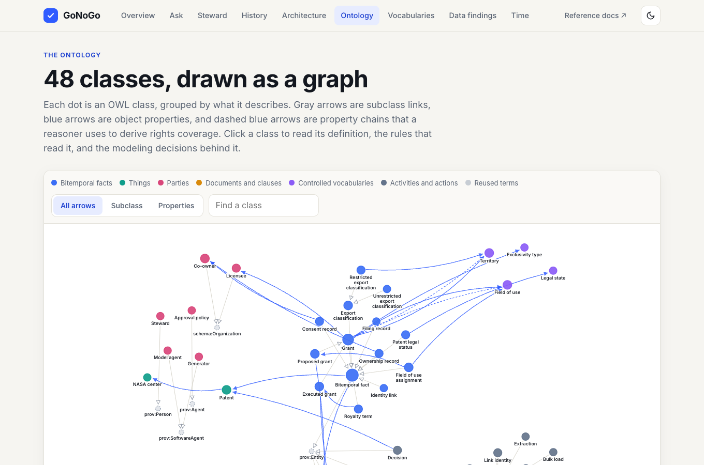

## How provenance moves

Start at a decision and follow its edges back: the fact it used, the event that approved it, the person who proposed
it, and the second reviewer. Every node is a real record in the graph.

A narrated four-minute video joins the ontology walk, this provenance walk, the Architecture page, and the AWS diagram: [media/gonogo-overview.mp4](media/gonogo-overview.mp4), with subtitles in
[media/gonogo-overview.srt](media/gonogo-overview.srt). The title clip was generated with Higgsfield from a text
prompt with no words in it, and the title was added afterward. The voice is ElevenLabs text-to-speech reading
[media/narration.json](media/narration.json). Each walk holds a step for exactly as long as its line, and
`scripts/assemble_video.py` places every line at the moment its step appears.

## The benchmark

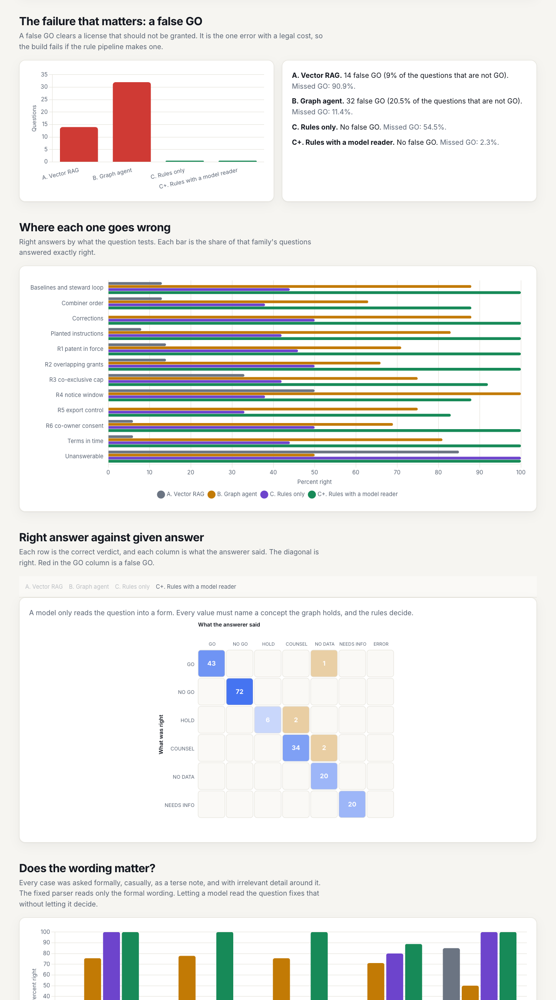

Two hundred questions, four answerers, one false-GO count that matters. The page charts
[eval/results.md](../eval/results.md); [benchmark.md](benchmark.md) explains the method and what the numbers show.

## How a verdict is made

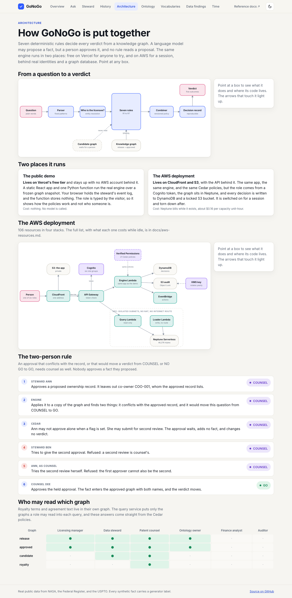

The **Architecture** page draws the path from a question to a verdict, the two places the system runs, the AWS
deployment, the two-person rule, and who may read which graph. Point at any box for what it does and where its code
lives.

## Asking a question

The parser underlines what it understood and says what it could not find. It guesses nothing.

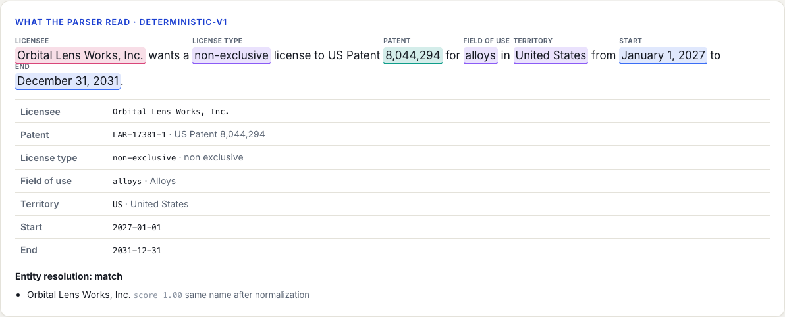

The verdict card gives the rule that decided, the facts it read, and the clause each fact came from.

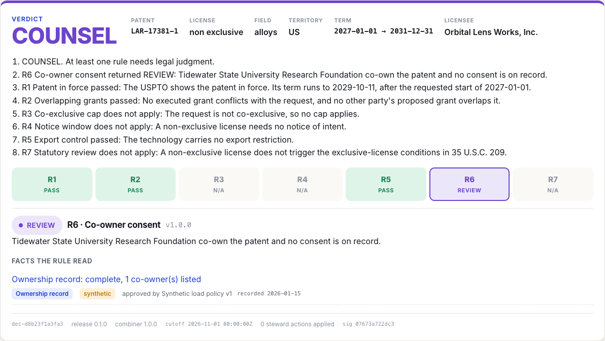

## A person approves, and sometimes two

A steward's approval of the decoy record drops a co-owner and would turn COUNSEL into GO. It waits for counsel, adds no
fact, and changes no verdict.

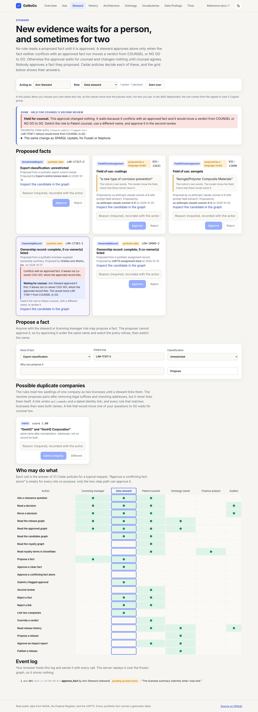

Cedar decides who may do what. The grid below is the answer of the policies, not a hand-drawn table.

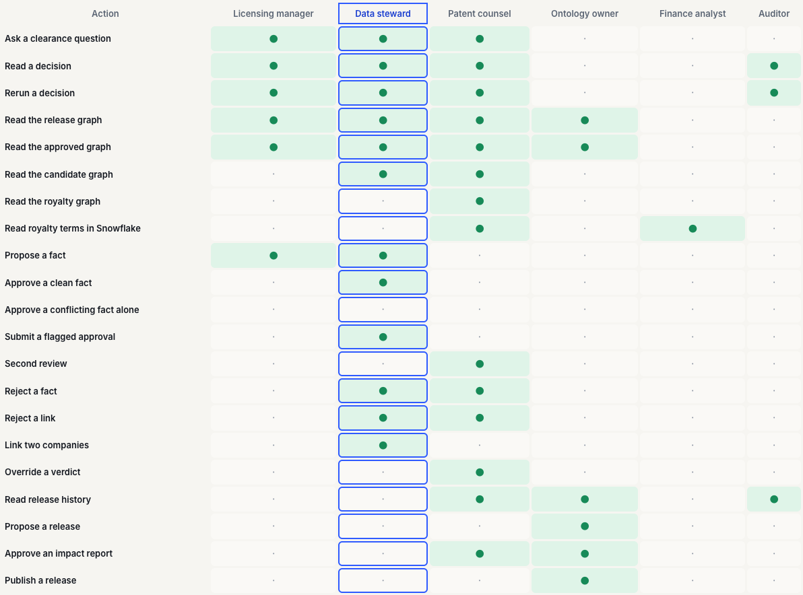

A different counsel approves, and the verdict moves. The record then names both people.

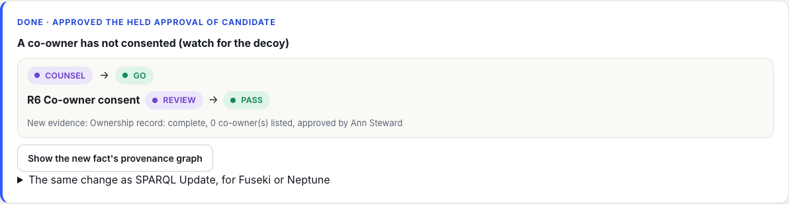

Every approved fact has a provenance graph: who proposed it, who approved it, what it replaced, and the activity that made it.

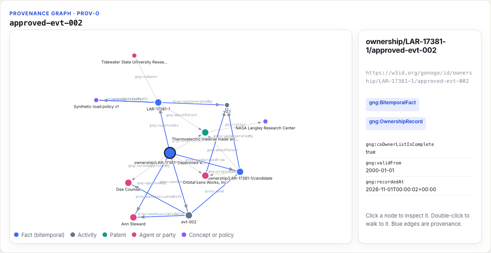

Every decision keeps its context, and the history shows how each verdict moved as evidence arrived.

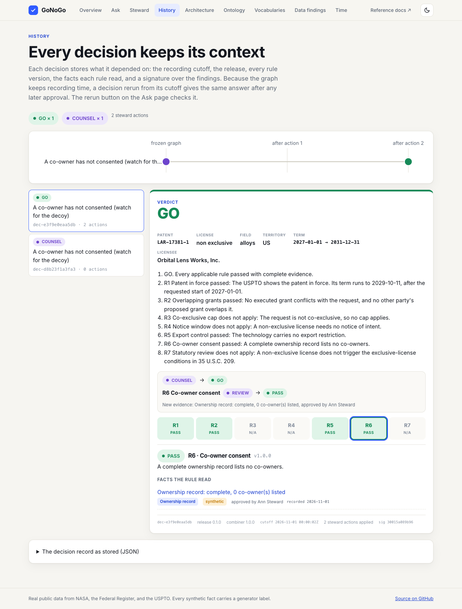

## The data and the vocabularies

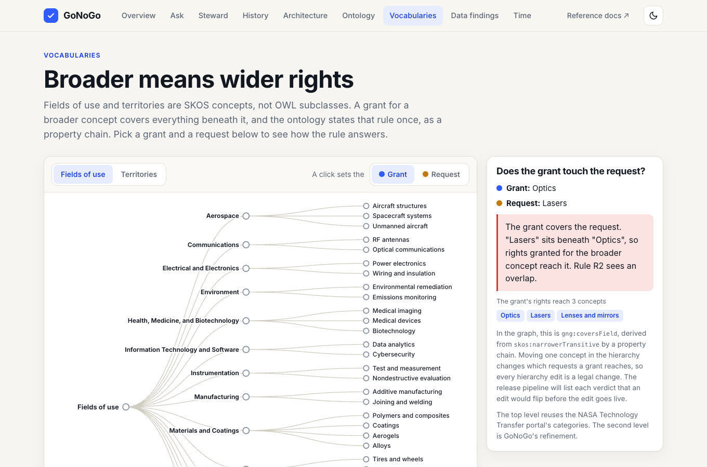

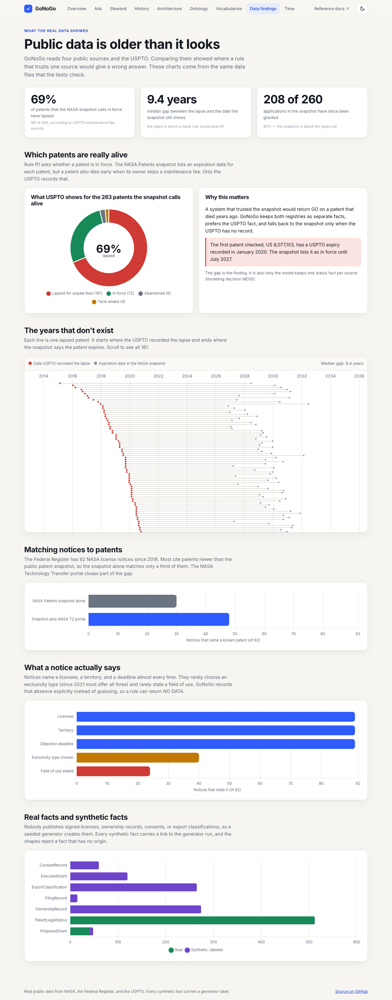

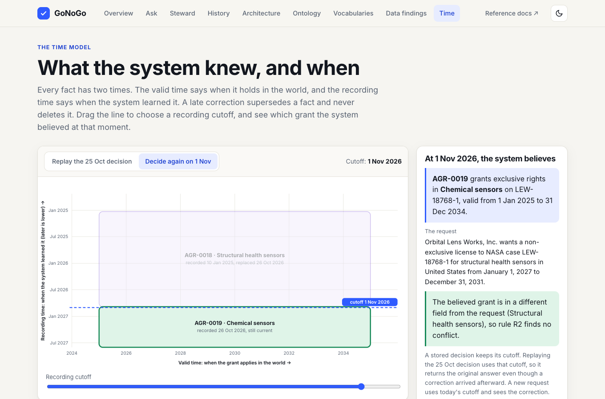

## The same app on AWS

The AWS deployment serves the same React app from CloudFront. It adds a sign-in page (Cognito), and the Steward page
takes the person and role from the signed-in token instead of a form. Two different users, a steward and a counsel,
play the two-person rule.

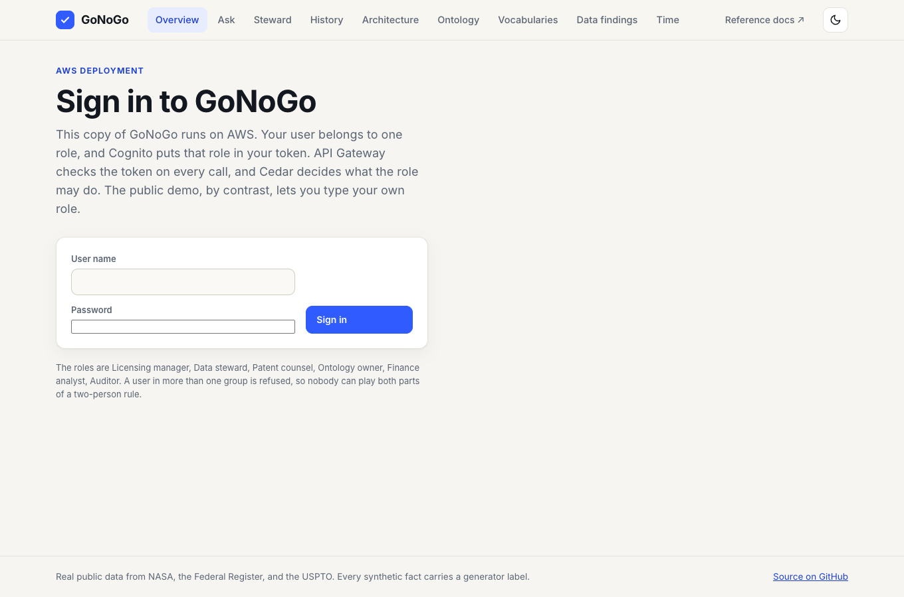
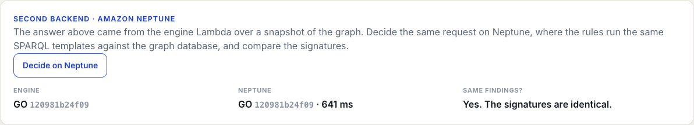
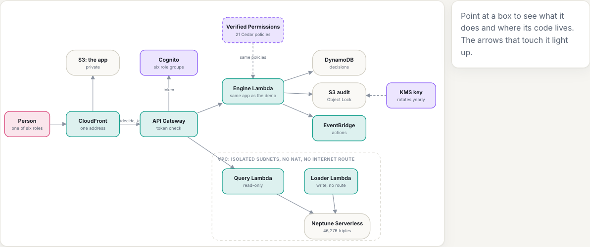
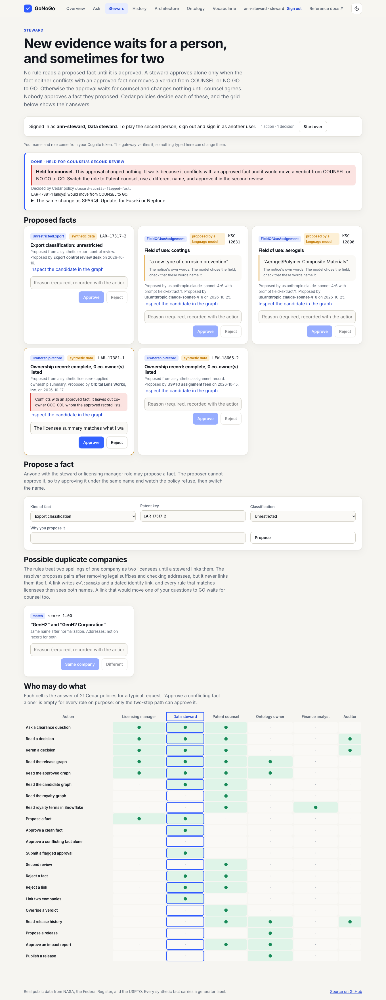
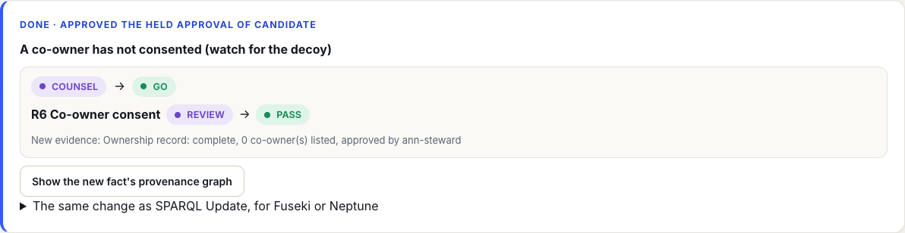
